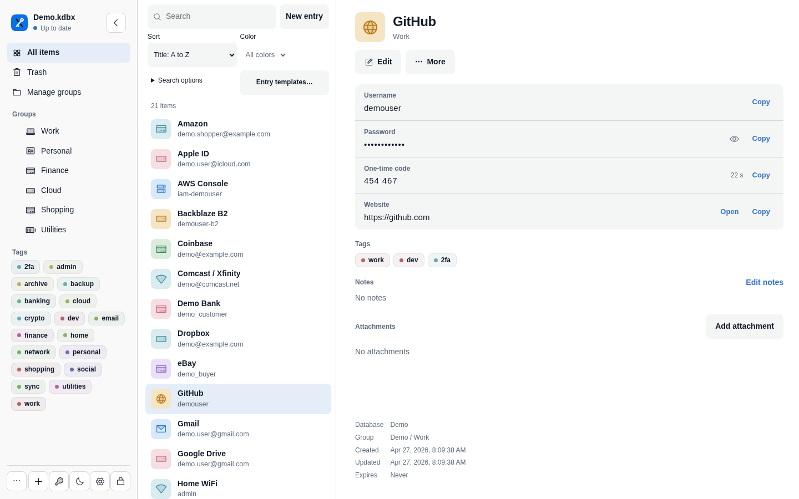
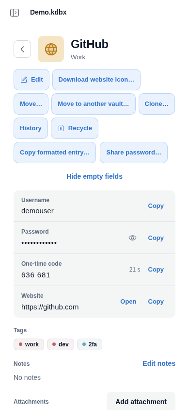

#  KeeWebX

**Open and edit a KeePass vault in your browser.**

[](https://keewebx.app/demo)
[](https://github.com/gynet/keewebx/releases/latest)
[](LICENSE)

[Open the app](https://keewebx.app/app) · [Try the demo](https://keewebx.app/demo) · [Download](https://github.com/gynet/keewebx/releases/latest)

<p align="center">
  
  &nbsp;
  
</p>

The current interface is the default for the app, demo, downloads and development server. [Classic is deprecated](https://keewebx.app/classic) and retained for compatibility. Both interfaces use the same vault, encryption and synchronization implementations. KeeWebX is a web-only fork of [KeeWeb](https://github.com/keeweb/keeweb), built with TypeScript, Preact and Bun.

## Use it locally

Download the recommended `keewebx-new-<version>.zip` or `.tar.gz` from [Releases](https://github.com/gynet/keewebx/releases/latest), verify its accompanying SHA-256 checksum, and extract the complete archive.

| Package | Homepage | Other entry points |
| --- | --- | --- |
| `keewebx-new-<version>` (recommended) | New | `next.html` |
| `keewebx-classic-<version>` (deprecated) | Classic | `classic.html`, `classic/index.html` |
| `keewebx-web-<version>` (combined compatibility bundle) | New | Both interfaces and in-app switching |

Each package includes its own assets and offline service worker. Standalone packages hide switching to the other interface. The combined bundle keeps `?ui=classic` compatibility routes.

Double-click `index.html`, or serve the extracted directory with any static HTTP server:

```sh
python3 -m http.server 8080
```

Keep the HTML files and bundled assets together. HTTPS or localhost enables features that require a secure context; passkeys also depend on browser and authenticator support. Direct `file://` use does not install the offline service worker.

KDBX encryption and decryption run in your browser. A browser-cache save does not update the external file you originally selected: download KDBX to save an external copy. Keep an independent encrypted backup. WebDAV synchronization and optional network features make requests only when configured or used.

See [the self-host guide](docs/self-host.md) for deployment details.

## New interface

- Open local KDBX files, use password and key-file combinations, configure supported passkeys, and work with multiple vaults.
- Edit entries, protected and multiline fields, groups, tags, expiry dates, icons and templates. Inspect and restore history; preview and manage attachments.
- Search selected fields, protected values and history with explicit options; use keyboard shortcuts, sorting, color filters and mobile navigation.
- Generate passwords, manage OTP credentials, review password warnings, and import or export supported formats.
- Save to WebDAV, see per-vault synchronization state, recover from offline or failed saves, and explicitly save or discard when closing a vault.
- Use browser autofill with KeeWebX Connect, with explicit access approval and session controls.

Use the sidebar’s database menu to save or close a vault. The key icon in the bottom toolbar opens the password generator. Entry details keep Edit and More actions together; copy, reveal and website actions stay beside their fields. Use a group’s `⋯` menu to manage it, and click an entry’s icon or choose Change icon and color from More to set a color flag. On a phone, the panel button opens the same navigation and tools.

Switching interfaces checks pending edits and saves before navigating. A failed save keeps the vault available for recovery.

## Browser extension

[KeeWebX Connect releases](https://github.com/gynet/keewebx/releases) provide browser autofill. Choose the app location in the extension, open and unlock a vault, then approve the connection in KeeWebX. Access can be limited to selected vaults and revoked from the app's extension settings.

For Chrome, Edge and Firefox, follow the [extension setup guide](modules/extension/README.md#connect-to-the-web-app). Use `https://keewebx.app/app` for the hosted app; replace old `/preview/` addresses. Setup and troubleshooting are also available in the extension's options, including before a connection succeeds.

For **iOS Safari with Userscripts**, install the experimental [KeeWebX Connect userscript](modules/extension/userscript/README.md) and authorize your unlocked app once. Focus a login field, tap the key and select a matching account. A temporary connection page finds the original app and closes after a verified handshake; subsequent requests use a direct MessagePort. Switching websites reuses the same authorization through the encrypted Connect protocol. Keep the app open and visit it if needed. Native iOS and standalone PWA acceptance remain unverified.

## Development

```sh
git clone https://github.com/gynet/keewebx.git
cd keewebx
bun install
bun run test
bun run build
```

The build writes both interfaces into `dist/`. Serve that directory to open the current interface by default. `bun run dev` starts the current interface at `http://localhost:8085`; `bun run dev:classic` explicitly starts the deprecated Classic development server.

| Package | Purpose |
| --- | --- |
| `modules/ui` | New interface, built with Preact |
| `modules/ui-classic` | Deprecated Classic compatibility interface |
| `modules/ui-kit` | Shared presentation helpers |
| `modules/vault` | Vault models, storage, synchronization and application services |
| `modules/db` | KDBX database library |
| `modules/extension` | Browser autofill extension |

Shared vault code does not import either interface. Browser acceptance covers New and Classic in Chromium and Firefox; individual tests identify browser-specific capability limits.

## License and credits

[MIT](LICENSE). Built on [KeeWeb](https://github.com/keeweb/keeweb) by Antelle and [kdbxweb](https://github.com/keeweb/kdbxweb). See [third-party notices](THIRD-PARTY-LICENSES.md) for bundled dependencies.
