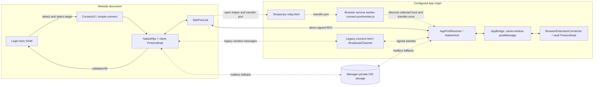
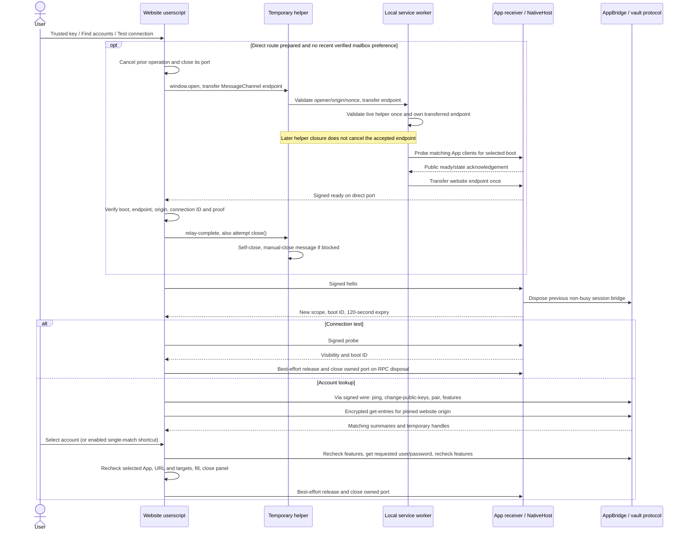
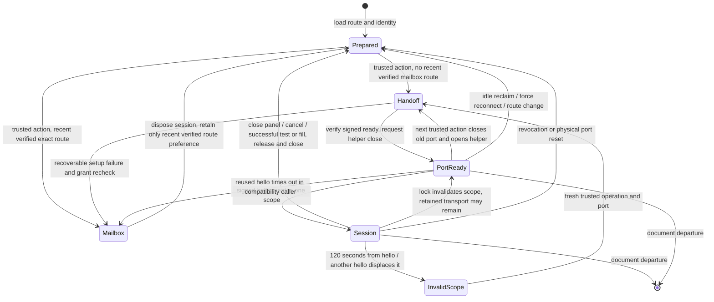

# Connect connection architecture

Architecture of **Connect 0.6.27**. This describes implemented behavior, not a
guarantee of browser recovery or native iOS acceptance. See the
[release notes](release-0.6.27.md) for changes and verification limits. The
[detailed technical analysis](technical-analysis-0.6.21.md) includes the paired
native failure timeline and subsequent lifecycle and receipt-ordering fixes.
The [0.6.27 dispatch analysis](dispatch-analysis-0.6.27.md) correlates worker send
times with both App receivers and separates confirmed delivery delay from
unproven browser-internal causes.

**Runtime and components.** [build-connect.ts](../build-connect.ts) bundles
[simple-connect.ts](../src/simple-connect.ts) as a browser IIFE with Bun, Preact and TweetNaCl.
The installer requests HTTPS pages, top-level documents, `document-idle`, content-world injection,
and GM storage/tab APIs. Startup excludes `/connect-port/`, claims one runtime in its script world,
then distinguishes the configured App, legacy `connect.html?kwx-native=1`, and login websites.
[ConnectUI](../src/connect-ui.ts) renders shared Preact components in a closed shadow root;
the script manager's execution/storage isolation is the security dependency, not the shadow root.

The worker above is a **local browser service worker**; discovery runs in the browser.
Its registration scope is the adjacent `connect-port/` directory; it has no fetch handler or
credential RPC server. It enumerates same-origin browser clients with `includeUncontrolled: true`
to reach the App outside that scope. Established MessagePorts bypass both worker and helper.
See [relay.js](../../../ui/connect-port/relay.js) and [worker.js](../../../ui/connect-port/worker.js).
The New App's [primary-window Web Lock](../../../ui/src/app-instance.ts) gates App ownership;
Connect discovery still selects the saved **App boot ID**, not whichever tab holds that lock.

**Trusted actions and form behavior.** [The website controller](../src/simple-connect.ts#L269)
keeps a detected anchor separately from a valid field selected by trusted `focusin`.
[Detection](../src/login-fields.ts) observes DOM/geometry changes and recognizes eligible login inputs;
it does not initiate a connection or read field values. The panel's trusted key click calls:

| Condition/action | Actual operation |
| --- | --- |
| Valid selected login field | Existing `lookup(event)` path, including optional single-match fill. |
| Detected recognized login field, no valid selection, probe enabled | Existing `testConnection()` path, started by the trusted key click. |
| No qualifying field, or relevant action disabled | No automatic test/lookup from panel open. |
| Explicit Find accounts | Snapshot targets; connect; perform full encrypted account protocol. |
| Explicit Reconnect to existing tab | Force a new direct handoff, or use the legacy connector, then test. |

The auto-test is a **trusted key action**, not periodic preconnect, page-load work or form-detection work.
`prepareDirect()` reads route/identity ahead of time; UI connection actions are disabled while preparation
is pending. `openDirect()` runs synchronously in the trusted action before any `await`, preserving the
popup activation opportunity. The UI passes `force=true` for every new lookup or test:
the old port is closed. Normally a new helper opens. A mailbox reply verified
within 30 seconds on the same document and exact grant selects a fresh mailbox
session instead. Explicit Reconnect clears that preference and opens a helper.
Lookup, account selection and fill share their transport within one operation.
Browser popup permission and document scheduling can still prevent setup.

The temporary helper closes after the website verifies the signed **port-ready** receipt, before
completion of `hello` or credential negotiation. The close command is bound to opener/origin,
nonce, connection ID and endpoint. Worker transfer alone does not authorize closing.
[SitePortLink.confirm/reset](../src/direct-ports.ts#L157) retains a helper reference when closure fails;
later cleanup uses a scoped command instead of blindly closing a potentially navigated window.

**Session versus connection.** [NativeHost.receive](../src/native-connect.ts#L272) owns one logical
session across all physical website ports. A new `hello` rejects while that session is busy;
otherwise it disposes the old bridge and creates a new scope. Thus even a successful connection
test can displace another website's idle account selection. There is no independent session per port.
`probe` and `release` perform no credential reads. A successful test authenticates a matching host
reply; it does not run the full account protocol or verify current listing permissions.
Its Connected status is a **last-check snapshot**, not a liveness lease or promise that the next lookup succeeds.

Account lookup separately creates the client [ProtocolImpl](../../src/background/protocol/protocol-impl.ts),
performs key exchange/pairing, and requires `website-matching-v1`, the expected origin, unlocked state,
pairing and listing access. It displays at most ten suggestions; optional automatic selection applies
only when the full suggested list has exactly one entry. [choose/fill](../src/simple-connect.ts#L242)
rechecks access, App selection and [target identity](../src/form-targets.ts) around field retrieval.
Filling dispatches input/change events and rechecks after writing the username before writing the password.
Connect never calls form submission; website event handlers can react to those events.

**Authorization and security boundaries.** App-side authorization uses a local `AppBridge` handshake,
requires an unlocked database and approved listing permission, then publishes the selected route under
an exclusive Web Lock. [NativeHost.authorize](../src/native-connect.ts#L208) commits a same-origin public
host marker after the GM route write and fences canceled publication. Silent restoration repeats the
permission checks, respects explicit disconnect's restore-block marker, and requires eligible App ownership
and the same stored identity. The New App's primary role may inherit a prior tab's grant; this does not
preserve old ports/scopes. Missing manager tab APIs limit owner continuity outside that primary-role case.

- **Transport authentication:** [port-auth.ts](../src/port-auth.ts) signs a domain-separated ready tuple.
  [NativeRpc/NativeHost](../src/native-connect.ts) sign canonical packet JSON and validate request/reply
  IDs, host, endpoint, document, origin, operation, scope and deadlines. The long-lived Ed25519 secret is
  shared by this installed userscript across App and website runtimes; it is not a separate App-only key.
- **Origin binding:** the helper checks browser-observed opener origin/source; the worker checks its
  browser-owned helper client/URL; the App receiver binds the transferred port to that site origin.
  NativeHost rejects a differing signed origin. Legacy window routing checks origins too; mailbox routing
  has no browser-observed website peer and relies on signed packets from the trusted userscript runtime.
- **Confidentiality:** fresh TweetNaCl `box` keys encrypt account protocol payloads. Pairing signs both
  session public keys under `kwx-pair-v1`. Ping/key exchange and outer routing metadata are not confidential.
  The App vault protocol and website client decrypt at their respective ends; helper/worker do not need keys.
- **Vault authority:** [AppBridge](../src/app-bridge.ts) permits six Connect actions and passes the pinned
  origin through same-window `kwConnect` messages. The [App connector](../../../vault/src/comp/extension/browser-extension-connector.ts)
  serializes one web connection; [vault ProtocolImpl](../../../vault/src/comp/extension/protocol-impl.ts#L933)
  enforces permissions, current database/access epoch, entry identity and handles. Website lists ignore
  caller-supplied search/URL scope and use [App-side URL matching](../../../vault/src/comp/extension/website-matching.ts).
  Matching checks hosts/ports, primary/additional URLs and a restricted leading `www.` alias, not URL paths.
- **Trust limits:** same-window/origin messages do not isolate the App from compromised App-origin code.
  GM isolation, the manager, App origin and injected userscript are trusted. After authorized fill,
  credential text intentionally becomes available to the website DOM.

**State and persistence.** Connect is stateful; discovery has no durable routing registry.

| Location | Stored state and lifetime |
| --- | --- |
| Manager-private GM values | [Identity](../src/identity.ts): base64 public **and secret** signing keys; [endpoint](../src/settings.ts); [single-fill preference](../src/preferences.ts); selected route containing host/owner/endpoint/public key, authorization revision and transport capabilities. These survive document reloads. |
| GM tab data | App owner and legacy website routing ID, via optional `getTab/saveTab`; not a MessagePort or unlock state. |
| App-origin localStorage | Public active-host marker and explicit-disconnect restore block; launcher position. Vault identity approvals/permissions persist separately in namespaced `runtimeData`, through [RuntimeDataModel](../../../vault/src/models/runtime-data-model.ts) and [SettingsStore](../../../vault/src/comp/settings/settings-store.ts). |
| GM mailbox | Temporary signed envelopes, including encrypted account wire payloads, plus a public wake hint. Deletion is best effort; deadlines enforce validity even if records remain. |
| Website memory | Cached route/keys, physical link and generation, pending RPCs, scope, ephemeral box keys, summaries, target references, operation deadline. A verified mailbox transport preference lasts at most 30 seconds from its last verified reply; no session or account data is retained by that preference. |
| App memory | Boot ID, active grant/keys, up to 32 physical ports, one session/bridge, replay IDs/receipts, ephemeral crypto and entry handles. The unlocked vault model is owned by the App. |
| Helper/worker memory | Temporary discovery channels, pending probes and transfer bookkeeping; the worker retains no established website-port registry after transfer. Browser SW registration can persist. |

**Fallback and bounded retries.** [NativeRpc.connectAttempt](../src/native-connect.ts#L525) chooses
a fresh logical session for each UI operation. A document-local
[MailboxRecovery](../src/mailbox-recovery.ts) retains only the exact grant, current
page URL and receipt time after a verified mailbox reply. For 30 seconds, the next
operation can use a new mailbox hello without repeating discovery. Epoch fencing
prevents a late completion from changing a newer operation’s preference. Failure,
expiry, route change, page departure and explicit Reconnect clear it. There is no universal
“retry everything” loop and no automatic creation of a replacement vault tab.

| Trigger | Implemented response |
| --- | --- |
| Discovery delay | Worker retries public probes, with up to two discovery rounds within a 16-second discovery budget; website setup has its own 25-second limit. Transfer of the website endpoint happens once. |
| Classified setup timeout or helper-unavailable failure, with mailbox capability | Try GM mailbox after verifying the saved host, public key and authorization revision. Structurally invalid requests and authorization denial remain fatal. |
| First `hello` timeout on a newly signed-ready port | One fresh hello may use that same port while the attempt deadline allows. |
| Low-level compatibility caller reuses a previously working port and `hello` times out | After a 3-second hello budget, discard the direct link, recheck the grant and try mailbox. The current UI starts fresh ports and does not take this reuse path. |
| Initial mailbox fallback with UI callback | Allow the existing separate 60-second visit/return phase; wait for website visibility before continuing. Lookup then restores its 30-second operation budget. |
| Recently verified mailbox route | Fresh signed hello with the ordinary 8-second budget; no renewed 60-second recovery wait. All grant fields and the operation generation must still match. |
| Older route without direct capability | Existing connector window uses `postMessage` plus same-origin BroadcastChannel; absent/unusable window can use advertised mailbox. This legacy connector remains open while carrying traffic. |

Direct hello and receipt-capable wire requests resend the **identical signed envelope** every 750 ms
within its original deadline. [AppBridge receipts](../src/app-bridge.ts#L82),
[ReplyReceipt](../src/reply-receipt.ts), and App connector execution IDs prevent duplicate execution;
republication passes current vault response guards. This is bounded receipt recovery, not unrestricted
re-execution of credential reads. Expired or mismatched responses are rejected.

There **is existing GM polling**: NativeHost calls `mailbox.start(!this.direct, !!this.direct)`.
With a direct receiver, the App checks a GM wake hint every **1500 ms**; mailbox responses poll at
**100 ms**, and scans recur at **150 ms** while requests are pending (or in legacy idle-poll mode).
Manager change events and App return events also wake scans. Direct credential RPC itself uses ports.
See [ConnectMailbox](../src/connect-mailbox.ts) and [manager-events.ts](../src/manager-events.ts).
The panel-open change adds no new background probes. Neither ports nor polling can force a suspended
browser document to execute; automatic recovery, native iOS behavior and standalone PWA reachability
are not established by this source review.

Panel close cancels logical work, clears account UI and disposes its `NativeRpc`, including its
physical port. A generation check prevents an older operation from releasing or closing a newer
port. Lookup retains its RPC while the account list is displayed, through selection and filling;
it is not disposed when list retrieval returns. Successful tests and fills also dispose their RPC.
Website pagehide resets the
website port and field observers; a BFCache return restarts observation/preparation, not the old scope.
Hiding the site preserves pending setup/lookup, but clears a displayed selection or an actual fill.
App lock disposes the logical bridge; unlock can resume the grant, never that old scope.
App pagehide pauses/revokes its runtime; reopening creates a new boot. Explicit disconnect also blocks
silent restoration. Port idle reclamation is ten minutes (App sweep every 30 seconds).
The effective account-selection lifetime is 120 seconds **from hello**; vault handles have a separate
five-minute ceiling and can be invalidated earlier. See [lifecycle controller](../src/simple-connect.ts#L374),
[host lifecycle](../src/native-connect.ts#L245), and [port cleanup](../src/direct-ports.ts#L288).

**Review findings and unresolved evidence.**

1. **Helper ownership after acceptance:** the worker validates the browser-owned helper
   client and its website origin before accepting the transferred endpoint. After that point,
   helper closure or navigation no longer invalidates discovery or final handoff. The selected
   App is still looked up again before transfer, and boot, endpoint, origin, signature and deadline
   checks remain required. Initial helper lookup failure still returns `helper-unavailable`;
   malformed attachment shape or origin returns `invalid`. The new helper requires
   `handoff-owner-v1` from the current controller before transferring its endpoint; a legacy
   five-field probe still receives `self-close-v1`. New local logs retain the allowlisted
   `relayCode` rather than collapsing all these cases into `unavailable`.
2. **Unbounded settings calls:** startup awaits [loadEndpoint](../src/settings.ts), and saving awaits
   `saveEndpoint`, without `managerCall`'s timeout. A GM promise that never settles can stall startup
   before UI creation or leave address saving pending. Other manager operations have explicit bounds.
3. **Expiry is not immediate disposal:** NativeHost rejects an expired signed `release`. Version
   0.6.22 also sends a close on the operation's physical port at disposal; when processed, the
   receiver removes that port and its matching bridge even if the signed release expired.
   Close cannot target a different port or replacement session. Abrupt termination without
   lifecycle events, and legacy/mailbox releases, still require eventual replacement, lock,
   pause or idle cleanup. Access remains expired, but remote memory cannot be described as
   immediately purged while its document is not executing.

The reported 0.6.19 website trace also shows a newly authenticated direct port
accepting seven sequential RPC replies before a later request stalls. This is
separate from helper classification and fallback preference. It does not establish
a stale-port cause: App-side receipt/response events for the same request ID are
needed to distinguish inbound delivery, the same-window App bridge, and return
traffic. A fresh query does not by itself guarantee that a suspended document runs.

The subsequent paired 0.6.20 trace establishes another failure: a reused port's
hello and all retries were dispatched by the App only after it became visible,
after the request deadline. Version 0.6.21 starts a new physical handoff for each
UI operation instead of treating earlier success as current liveness. Independently,
the App restoration guard now skips an already-authorized runtime and records a
successful explicit authorization as attempted. This prevents unintended repeat
publication after cached-page return or unrelated body mutations; it does not
establish the cause of delayed browser dispatch.

The paired 0.6.21 close/reopen trace narrows the remaining failure further. A new port completed
six RPCs; the seventh request was sent at 13:11:57.310 and first entered the App port callback at
13:12:51.812, a 54.502-second delay. Its retries and cancellation release were then rejected as
expired. Authorization stayed at generation 3 during that failure. Thus fresh handoff alone did
not fix the mid-operation stall. The trace locates the delay before the App port callback, not
inside the vault account handler; it cannot distinguish browser document scheduling from
userscript-world scheduling. Version 0.6.22 repairs disposal, not this unexplained dispatch delay.

Version 0.6.23 also repairs a separately reproduced receipt-ordering race. A queued
duplicate can be revalidating its receipt after the website has already received
the original reply and sent the next request. The next unique request reserves the
normal request slot and waits for replay to leave the App bridge, then rechecks
its original session, grant, lock state and deadlines. Duplicate replay owns a
separate transient promise and cannot clear the next request's busy flag. No
credential read is replayed and no deadline is extended.

The local recording preference persists in manager-private GM storage as a boolean;
userscript events remain a 300-line in-memory ring in each document. The New App
adds an opt-in 100-event passive page-world ring. Export correlates its public
trace IDs with the userscript callback-entry timestamp (`dispatchAt`) and data-read
duration (`elapsedMs`). It never touches transferred endpoints or calls
`startMessages()`. A nonce-bound same-window snapshot exports only allowlisted
metadata, and a promised clipboard Blob preserves the trusted click on Safari.
Disabling recording clears the observer ring. There is no remote upload,
credential data, website address or persisted event history.

## Suspension recovery in 0.6.24

Receiver authorization and current execution are separate states. A cached page
return can occur before the App has reacquired primary ownership. The receiver
keeps one pending-resume flag and observes the App role attribute, then resumes
its existing grant after ownership is established. A departure or explicit
disconnect cancels that pending work.

A late `AbortError` from a previously held Web Lock permits one normal foreground
reacquisition. Generic acquisition errors and hidden Apps do not retry in a loop.
Browser arbitration still decides which App is primary. This fixes two controlled
lifecycle reproductions; it does not prove the cause of native iOS callback delays.
See [0.6.24 evidence and flow](release-0.6.24.md).

## Verified recovery in 0.6.26

The supplied 0.6.25 trace shows a mailbox probe succeeding at 06:34:28.515,
followed by a new helper at 06:34:32.334. The working recovery choice was lost
between two trusted operations. The 30-second, exact-grant preference fixes this
reproduced loop without retaining a session or claiming background liveness.

The first discovery delay is separate: the App callback ran at 06:34:26.451,
after the worker’s 06:34:12 timeout. Its underlying cause is not established.
Passive logging now separates page-world receipt from userscript-world entry
without changing dispatch or authentication. See the
[0.6.26 evidence, component diagram and sequence](release-0.6.26.md).

## Inspecting pending setup in 0.6.27

Opening Connection to inspect a pending test or lookup preserves that operation,
its helper/port and its progress. Explicit cancellation and replacement still
dispose owned resources. Local action labels distinguish these paths. Discovery
probes also carry their connection ID and actual worker send timestamp so both App
observers can correlate receipt without using timing as authorization evidence.
See the [regression analysis and flow](release-0.6.27.md).
