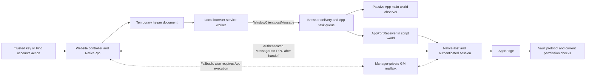
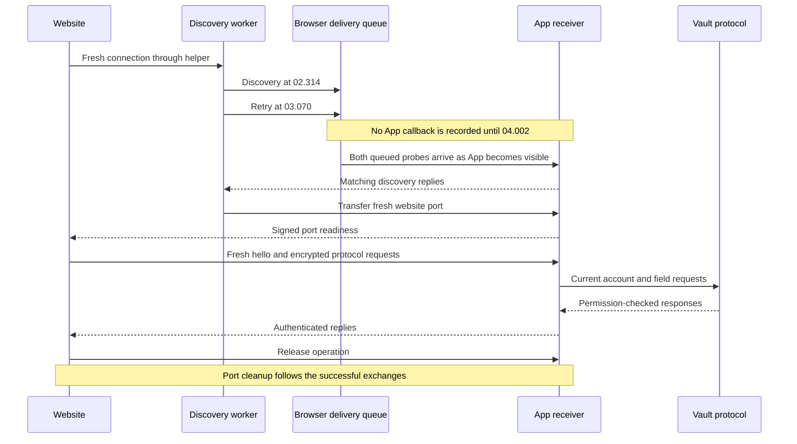

# Connect 0.6.27: paired discovery-delivery analysis

**Status: the reported native iOS background-delivery problem remains unresolved.**
This report locates the observed wait and records a controlled browser experiment.
It is not a new Connect release or a claim that desktop tests certify iPhone behavior.

The supplied paired logs now contain an overlapping operation, worker send times,
both App receiver callbacks, and the complete subsequent protocol exchange. The
previous 13:21 excerpts lacked corresponding App records. The new 13:25 operation
provides the missing correlation.

## Observed timeline

The following rows refer to the same website connection and discovery trace. IDs
are omitted here; they are used to correlate the supplied logs, not to authorize
an operation. Times are UTC.

| Time | Observation | What it establishes |
| --- | --- | --- |
| 13:22:57.665 | App becomes hidden | The existing unlocked, authorized App remains the selected runtime. |
| 13:25:01.492 | Trusted website panel-open action | A new operation starts. |
| 13:25:01.570 | New helper opens | The operation is not reusing the previous physical port. |
| 13:25:02.293 | Helper ready | Helper startup has completed. |
| 13:25:02.314 | First worker discovery send timestamp | The worker calls `WindowClient.postMessage` with a fresh probe channel. |
| 13:25:03.070 | Retry send timestamp | A second probe is posted for the same discovery. |
| 13:25:04.002 | Main-world App observer enters, `visible=true` | First observed App callback is 1,688 ms after the first send. |
| 13:25:04.003 | Userscript receiver enters | Only about 1 ms separates the two App observers. |
| 13:25:04.004 | Retry delivered; discovery replies posted; visibility event recorded | The retry waited about 934 ms. Both probes now get matching responses. |
| 13:25:04.011 | App receives the website port | Handoff completes in the same App runtime. |
| 13:25:04.032 | Website verifies port readiness | Signed connection authentication succeeds. |
| 13:25:04.033–04.234 | Nine request/reply exchanges succeed | Subsequent protocol traffic is responsive. |
| 13:25:04.238–04.241 | Operation releases and closes its port | Cleanup follows successful replies; it did not cause the earlier discovery wait. |
| 13:25:05.779 | App becomes hidden again | No App reload, grant change or new vault unlock appears in this operation. |

The App authorization generation stays at 2, with one receiver runtime. Its main
observer reports zero event-data read time. There is no matching RPC timeout or
authorization rejection in this operation. The accepted actions and current
controller code are consistent with the single-match autofill path; these logs
do not record DOM field values and cannot independently prove the filled values.

The helper-ready-to-port-received interval is 1,730 ms. Port-ready-to-final-accepted-
reply is about 202 ms. From the first App callback to operation cleanup is about
237 ms. The substantial observed wait is **before the App's receiver callbacks**.

These are wall-clock diagnostic timestamps from one device, not a browser IPC
trace. No evidence of a clock adjustment appears in the excerpt. They do not
identify which WebKit queue, process state or scheduling policy delayed dispatch.

## Components and execution boundary

The worker is a local service worker, not a remote server. The main observer only
records optional public timing metadata; it never answers discovery or takes a
transferred port. Both App callbacks are downstream of browser delivery. Once
handoff succeeds, credential RPC bypasses the helper and discovery worker.

## Why another reset is not an established fix

Fresh physical ports are already used for the three supplied operations at
13:21:22, 13:21:32 and 13:25:01. The new operation must still deliver its discovery
message through the same browser-to-App boundary. Clearing its predecessor does
not make that destination execute.

Persistent authorization, App document identity, ephemeral port/session state,
and browser execution state are separate concerns:

| State | Required handling | Effect on the observed wait |
| --- | --- | --- |
| Explicit authorization | Preserve until revoked; verify current grant | It is already valid in the supplied run. |
| App document identity | Rebuild after actual document recreation; reject old identities | No document recreation appears during the correlated operation. |
| Operation/session/port | Dispose on completion or cancellation; fence late replies | Fresh operation resources are already present here. |
| Browser execution/delivery | Controlled by the browser | Resetting JavaScript objects does not establish that queued callbacks will run. |

`Authorized` on the App panel is not a liveness measurement. A past successful
website request also does not guarantee that a later discovery will be scheduled
promptly. Increasing a deadline can keep a request pending longer; it does not
repair delivery. A mailbox fallback still needs App-side JavaScript execution.

## Controlled browser experiment

Run the existing actual-App acceptance harness with
`KWX_FOCUS_DISPATCH_PAUSE=1`. It uses the released 0.6.27 installer, native browser
service workers/MessagePorts, an encrypted disposable KDBX, native vault consent,
and the existing GM adapter. Chromium CDP deliberately freezes the App task
queues before a fresh lookup, then resumes the same document without focusing it.
Production request handlers and cryptography are not replaced.

The experiment checks that no signed port readiness or fill occurs during the
pause; queued discovery arrives after resumption; the fresh operation then fills
with the App still hidden. It also cancels a paused operation, checks that late
delivery cannot fill, and verifies that the next trusted operation succeeds.

This is **fault injection**, not an assertion that Chromium's CDP freeze is the
mechanism used by iOS Safari. It shows that a wait before callbacks is sufficient
to produce the observed symptom, and that the current protocol does not itself
require a foreground App once the browser allows it to execute. See the run's
generated `report.json` for measured delays and validation scope.

The completed run used installer SHA-256
`745f0db55da87949e93c3e73e2cb4e48e25608f2c50440af4d1174ac485775ad`.
All six setup/acceptance steps passed. The three behavioral checks were:

| Injected scenario | Result |
| --- | --- |
| Freeze before fresh discovery, resume without App focus | Discovery waited 3,014 ms; autofill completed with the same unlocked App still hidden. |
| Cancel while frozen, then resume | Discovery waited 3,054 ms; canceled operation left both fields empty. |
| New trusted lookup after cancellation | Autofill succeeded; no extra consent, App navigation or App focus was required. |

Both diagrams in this report were rendered successfully. These results support
the boundary analysis, not a claim that the native iOS problem is fixed.

## Automatic focus is not a verified recovery mechanism

`WindowClient.focus()` is activation-gated. Existing browser acceptance found the
correct original client but received `InvalidAccessError` from the native call.
The API being present is not proof that a website-created helper can use it to
wake a different App tab. Reloading or navigating the vault as a wake-up tactic
would need separate evidence that document identity and unlocked state survive.
Neither tactic is included in this investigation.

Primary references:

- [Service Workers specification: focus](https://w3c.github.io/ServiceWorker/#client-focus)
- [WebKit ServiceWorkerWindowClient implementation](https://github.com/WebKit/WebKit/blob/main/Source/WebCore/workers/service/ServiceWorkerWindowClient.cpp)
- [WebKit ServiceWorkerContainer implementation](https://github.com/WebKit/WebKit/blob/main/Source/WebCore/workers/service/ServiceWorkerContainer.cpp)

The WebKit source is explanatory upstream source, not proof of the exact version
or execution state on the user's device. No specific WebKit defect is assigned.

## Release decision

Do not label a timeout increase, another reset, a new logging field, or this
passing desktop experiment as a fix for native iOS background delivery. The
remaining acceptance requirement is: on native Safari with Userscripts, after
App/browser reopen and unlock, repeatedly discover and fill from different sites
without manually foregrounding the App. This investigation has not met that
requirement. The deployed connection implementation stays at 0.6.27.
