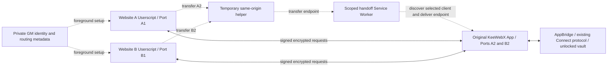

# MessagePort Connect architecture

The production Userscript reuses KeeWebX Connect's signing identity, encrypted
protocol, native database permission and App-side website matching. The new
transport removes a permanent connection page from the credential data path.

Dashed arrows are startup only. Each website creates a MessageChannel and keeps
port1. A helper opened synchronously from the trusted tap verifies its opener,
origin, nonce and endpoint, then transfers port2 to a worker registered only
under `connect-port/`. The worker finds same-origin top-level clients, probes
the selected App boot ID, and transfers port2 to exactly that App. The worker
retains no channel endpoint. Transfer alone cannot close the helper: the website
first verifies the App's signed ready receipt, then sends a scoped command for
the helper to close itself. Failed setups use a separate scoped cancellation.
The helper requires a matching capability reply
from the current worker before attaching, so an old activated worker with the
same URL cannot handle the first connection during an update. The App signs a
transport-ready receipt binding its boot ID, fresh connection ID, endpoint and
website origin. The website verifies that receipt and completes the existing
signed RPC hello before creating its encrypted account-selection session.
Helper closure is UI cleanup, never evidence of authentication. A verified
website sends the closure control to its own helper; if a cross-window
close silently fails, it retains the reference until closure is observed. If
self-close is refused too, the helper provides an explicit manual close action. All subsequent Connect requests bypass both helper
and worker.

## Boundaries

- The helper and worker receive public routing metadata and transferred objects,
  not stored credentials or private signing keys. Neither decrypts Connect data.
- A port is not JSON and cannot be persisted. Routing IDs locate a selected
  receiver; they do not restore a lost MessagePort or WindowProxy.
- The App binds the actual opener-origin metadata to each physical port. A
  packet cannot override that origin, document, scope, connection or selected App.
- Signed envelopes include origin, host, endpoint, document, scope, unique request
  ID and deadline. Replay, cancellation, vault locks and permission checks remain.
- The App decrypts its database and returns matching summaries. Only explicitly
  selected fields travel using the existing encrypted Connect protocol; the
  Userscript decrypts that response immediately before its guarded form fill.
- The App's public selection marker is stored synchronously on its own origin.
  The private GM route and this marker are committed under the same Web Lock.
  Direct requests check the marker before admission and after awaited work.
  Extension storage is outside the background message path.

Discovery acknowledgements use only in-memory receiver state. Worker source and
port checks run before the snapshot; discovery never waits for GM or WebStorage.
A saved endpoint mismatch produces an explicit state response instead of a silent
timeout. The public acknowledgement is not a credential grant: port admission and
every signed request still check the selected App lease, and the existing
signature, origin, deadline, replay and native permission checks remain in force.

## Lifetime

There is one physical port per website document and original App document.
Closing the helper or stopping its worker does not affect established ports.
Page unload releases a website endpoint. The App prunes idle endpoints after ten
minutes; pruning also runs when a new connection arrives or an old endpoint is
used. Normal UI cancellation releases its logical protocol session without
closing a healthy physical port. Account-selection scopes expire after 120
seconds. The existing native App bridge serializes encrypted sessions rather
than sharing account handles across websites.

Locking the vault cancels data access while leaving transport available for a
safe retry after unlock. Revocation closes ports, cancels bridge work, and makes
late replies unusable. Explicit disconnect also persists a local restoration
block until an explicit authorization, so unavailable GM cleanup cannot silently
restore a revoked grant after reload. Private route deletion requires a bounded
ownership read while holding the route lock; unknown ownership leaves stale
discovery metadata without enabling the revoked receiver. Changing the selected App invalidates the previous grant
synchronously and sends storage-event cleanup to other App documents. App reload,
website reload, abnormal termination and timeout require fresh channel endpoints;
reconnection always discovers an existing selected App and never navigates an
unlocked database to create a replacement.

The active hello receipt can be repeated for the identical request on its original
port and deadline. New App builds also support exact-once wire delivery. The
website repeats the identical signed request, while NativeHost retains only its
request binding. It asks the main App to revalidate the original execution ID
instead of reading fields again. The main App retains one original encrypted
response in memory until the request deadline and reruns `prepareResponse` before
every publication, including current permission and entry-lifetime checks.

A fresh `kwAttempt` distinguishes each revalidation from a delayed original
response. Periodic transport retries preserve that attempt. Neither retries nor
revalidation create a new Connect execution ID, cryptographic nonce or field
query. The original deadline, exact request, origin, physical port, logical
session, selected App and key generation still bind the operation. Cancellation,
lock, invalidation and replacement discard receipts. No receipt enters GM or
persistent storage. Older Apps keep their single-send path until capability is
confirmed by a matching App response.

Each lookup or selection has one 30-second budget across its stages. Closing the
panel through either control cancels it, releases pending work and rejects late
results. A stale local bridge receives an explicit error instead of a silently
dropped request. Queue cleanup is protected by `finally` and its generation.
Direct-port Apps listen for compatibility-storage changes without idle GM polling;
legacy-only receivers retain their existing polling path.

## Acceptance scope

The independent transport POC passed reported iPhone Safari testing with two
websites, automatic helper closure, the same original App, and hidden-App pongs.
Production acceptance separately covers encrypted listing/filling, origin
binding, cancellation, lock/revoke and blocked App-side GM storage. Desktop
browser fixtures do not certify physical iOS autofill, operating-system
suspension, or standalone PWA discovery.
