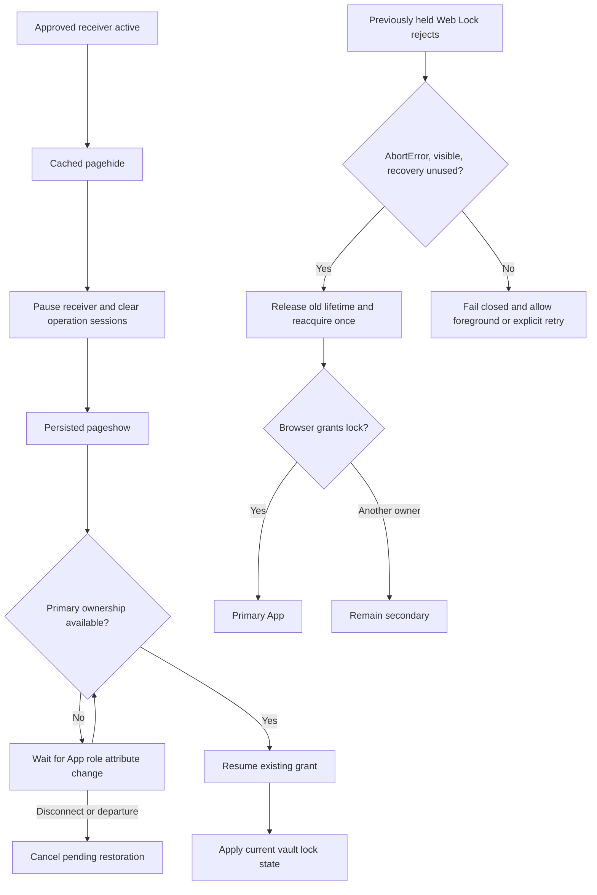

# Connect 0.6.24: recover approved receivers after page suspension

This release fixes two reproduced lifecycle defects. It does **not** establish
that the native iOS background-message delivery fault is resolved.

## Fixed behavior

1. **An approved App could stay paused after returning from the back-forward
   cache.** Its `pageshow` handler tried to resume while primary ownership was
   still `checking`. The retained `authorized` flag then prevented later
   restoration. The receiver now waits for primary ownership and resumes its
   existing grant when that attribute changes. It does not republish the grant,
   repeat pairing or request consent. Disconnect or page departure cancels this
   pending restoration.
2. **A late Web Lock rejection could strand a foreground App in an error state.**
   If a previously held lock rejects with `AbortError` after foreground events,
   the App now attempts one normal reacquisition in that visible episode. It
   clears the old lifetime and client locator first. It never steals another
   tab's lock; hidden Apps wait for return, stale attempts are ignored, and
   startup failures or generic errors do not trigger automatic retry loops.

Only lifecycle restoration changes. Discovery, helper closure, operation ports,
request retries, mailbox fallback, authentication, vault permissions and their
existing deadlines are unchanged. No remote diagnostics or persistent routing
state is added.

## Failure analysis

The supplied 0.6.23 trace demonstrates a separate unresolved boundary:

| Observation | Meaning |
|---|---|
| Website discovery expires at 16:03:06.154 | No direct connection was established |
| App begins processing the delayed discovery batch at 16:03:12.538 | The receiver callback starts after the attempt ended |
| App reports zero ports and no session | Clearing an old connection cannot explain this attempt |

The callback delay is not explained by the two reproduced restoration defects.
Earlier logs also show a newly established port serving several requests before
delivery stalls. Neither fresh ports nor more retries prove that background
execution is available.

A helper button using `WindowClient.focus()` was investigated but is **not shipped**
in this release. A trusted click was insufficient in the initial desktop browser
experiment. Adding a button without demonstrating reliable switching would add
another uncertain recovery path. Existing manual App switching remains available.

## Lifecycle flow

## Validation and limits

Regression cases cover return-before-primary, disconnect/departure while waiting,
late suspension rejection, bounded retry, hidden return, another live owner,
initial acquisition errors, and stale attempts. The old implementation fails the
new recovery cases.

Validation completed for the release candidate:

- 619 userscript and website-matching unit tests passed.
- 19 App-instance and return-path unit tests passed.
- TypeScript checking and the production New UI build passed.
- Chromium: App refresh/close/reopen recovery completed 17 fills across two
  websites with no new consent prompt; repeated script injection also completed
  six fills with one receiver.
- Desktop WebKit: real App close/reopen restored the encrypted vault and saved
  grant, followed by three fills and two connection tests with no new consent.
- Chromium and WebKit: cached-secondary lifecycle and hidden-primary ownership
  checks passed. These lifecycle signals are controlled test inputs, not native
  iOS process suspension.

Browser acceptance uses the real App and encrypted KDBX.
Desktop Chromium/WebKit with an adapted script manager do not certify native
Safari or the iOS Userscripts extension. Native iOS stability remains unverified.
