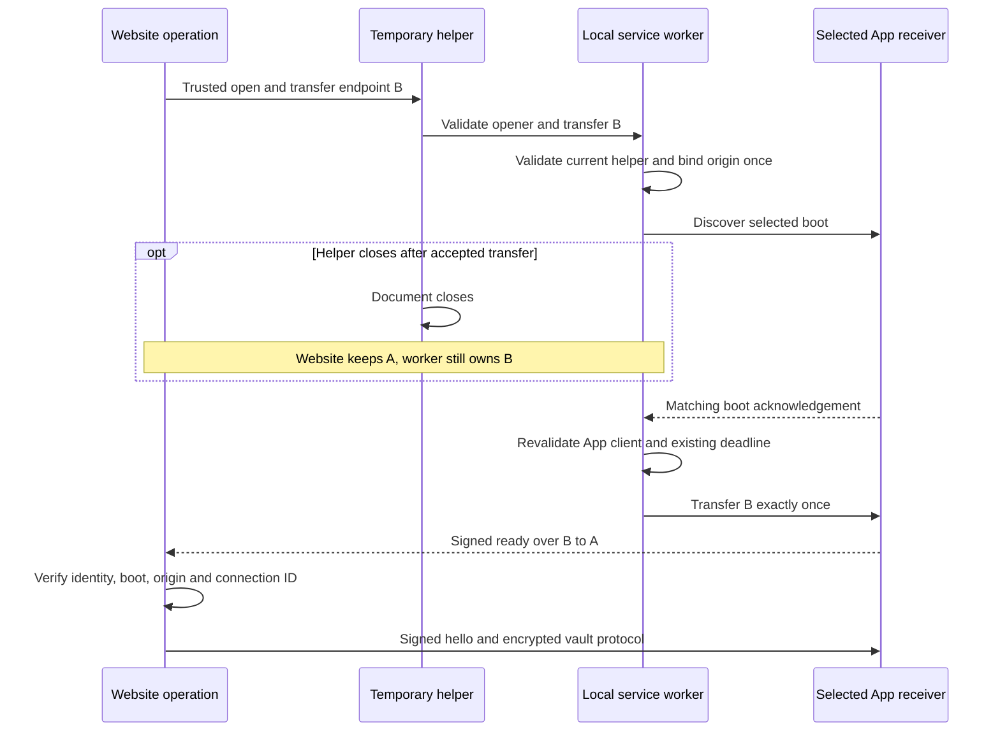

# Connect 0.6.25: preserve accepted handoffs when the helper closes

The routing worker could reject an already accepted website port because its
temporary helper had subsequently closed or changed. The worker now owns that
accepted endpoint until discovery finishes. Helper lifetime no longer cancels
the handoff; website cancellation and authentication still apply.

This defect is reproduced with actual helper closure in Chromium and WebKit.
It is not proof that every failure reported after restarting native iOS Safari
has the same cause. In particular, delayed execution of the App's receiver
callback remains unresolved.

## Evidence from the supplied 0.6.24 logs

The website and App timelines must be joined by connection or request ID, not
just by nearby timestamps.

| Trace | Observed sequence | What it establishes |
| --- | --- | --- |
| Website `2ce17241…` | Helper ready at 04:48:56.934; `unavailable` at 56.953 | Setup failed after 19 ms, rather than exhausting the discovery budget. The App excerpt starts later, at 04:49:05.819. The exact error code was not retained. |
| App `41bc6a90…` | Two RPCs reply at 04:49:29; its port is then canceled | This is a different connection from the website excerpt's `34613505…`. It cannot prove that the latter handoff completed. |
| Website `34613505…` | Helper ready at 04:49:33.981; port received and `unavailable` at 39.585 | The worker could report an error through the transferred port. A local `port-received` event is not itself signed App readiness. |
| Request `bbc2c7bd…` | Mailbox hello sent at 39.598; App replies at 39.628; website accepts at 39.638 | Mailbox exchange worked in this foreground interval. It does not establish that subsequent encrypted requests or background delivery worked. |
| App authorization | Generation 1 becomes disabled generation 2, then authorized generation 3 at 04:49:43 | Authorization changed during the trace. Generic interaction events do not identify which control the user pressed. |
| Website `21f15b7c…` | Discovery expires at 04:50:16.006; later mailbox request `3f107466…` is canceled before the App reads its signal at 56.662 | The later App callback cannot revive the canceled operation. Increasing a timeout would not repair ownership or cancellation semantics. |

The previous logger compressed several routing failures into `unavailable`.
Version 0.6.25 adds an allowlisted `relayCode`, including `noapp`, `refreshed`,
`helper-unavailable`, `disabled` and `app-timeout`. Arbitrary error text, origins,
account values and credentials remain excluded. Recording stays optional and
local; there is no telemetry upload or remote command channel.

## Components and ownership

The existing [component diagram and full protocol sequence](connection-architecture.md)
describe the Userscript UI, NativeRpc, direct ports, AppBridge and vault protocol.
This change is confined to the helper/worker routing boundary and local error
classification.

| Component | Lifetime and authority |
| --- | --- |
| Website operation | Owns its MessageChannel endpoint and cancellation. Each trusted new lookup/test creates a fresh physical handoff. |
| Temporary helper | Validates the opener, website origin and nonce; transfers the other endpoint to the local service worker. It is a courier, not the owner of the accepted operation. |
| Local service worker | Validates the live helper once, freezes the origin/endpoint/boot binding, discovers the selected App and transfers the endpoint once. It has no credential server or fetch handler. |
| App receiver | Checks worker, selected boot, endpoint, connection ID and deadline; signs readiness. It passes authenticated requests to the existing vault protocol. |
| Durable manager storage | Keeps the identity, approved App route and user preferences. It does not persist MessagePorts or claim that an old browser process is still connected. |

The old worker performed another helper lookup before the second discovery round
and again before final transfer. Both checks could discard a valid endpoint after
the helper disappeared. The successful historical MessagePort POC did not have
this extra lifetime dependency. The production fix removes those two checks while
retaining the initial live-helper validation and final App lookup.

The existing discovery and handoff deadlines, replay handling, session expiry,
fresh-operation behavior, vault consent and Web Lock ownership are unchanged.
A helper that is already invalid before acceptance still fails. A different,
closed or navigated App cannot receive the selected App's handoff. Closing the
website or canceling its operation still closes its own endpoint; merely closing
the courier cannot authorize a credential read.

## Worker upgrade behavior

The helper requests `handoff-owner-v1` from its current, activated controller
before transferring the endpoint. An older controller with the same URL cannot
satisfy that capability check. The existing registration/controller-change path
loads the new worker within the existing startup budget.

The worker also accepts the legacy five-field capability probe and responds with
`self-close-v1`, preserving compatibility with already loaded old helpers.
Unknown protocols, additional fields, invalid sources/origins and unexpected
transferred ports are rejected. No authorization reset is needed for the upgrade.

## Verification and limits

The committed [helper lifetime browser test](../tests/helper-lifetime.mjs) uses
real service workers, helper windows, MessagePorts and real elapsed time. Its App
is a synthetic metadata/ping fixture, so it does not claim credential or signed
handshake acceptance.

- Against the unchanged 0.6.24 worker **and relay**, closing the helper during the
  first probe or before the second round fails with `helper-unavailable` in both
  Chromium and WebKit: four expected failures. Normal self-close still passes.
- With this fix, all six browser routing checks pass. The ten-second resume case
  transfers exactly once and exchanges one ping/pong after helper closure.
- Worker unit regressions cover closure/navigation after acceptance, initial
  invalid-helper rejection, selected-App revalidation, bounded recovery and both
  capability versions.
- The new [full browser restart acceptance](../tests/port-connect.mjs) terminates
  the Chromium process, proves its PID has exited, then relaunches the same
  profile. It checks preserved manager storage, a saved KDBX, identity and grant
  restoration without new consent, a website opened before the lazy App, stale
  boot rejection, and repeated cross-site filling. The 0.6.24 baseline already
  passes this desktop scenario; it does not reproduce the native iOS defect.

Final release-candidate checks:

| Check | Result |
| --- | --- |
| Userscript, routing, authentication, lifecycle and URL matching units | 636 passed, zero failures |
| TypeScript and production UI build | Passed |
| Actual Chromium process close/relaunch with the same saved profile | Passed; 12 successful fills after restart, no additional consent |
| Desktop WebKit App close/reopen | Passed; three fills and two repeated connection tests after reopening |
| Upgrade from the 0.6.24 worker | Passed; no attachment to the old controller, new capability acknowledged, encrypted fill succeeded |
| Helper lifetime routing in Chromium and WebKit | Six passed; four expected failures against the unchanged 0.6.24 baseline |
| Release and architecture Mermaid diagrams | Four diagrams rendered successfully |

Native Safari process restoration, its Userscripts extension scheduling and
background callback delivery require native-device evidence. Desktop Chromium
and WebKit acceptance must not be described as proof that these are fixed.

## Upgrade

Update the existing `keewebx-connect.user.js` installation, save any database
edits, and reload the original App and website so both show **Connect 0.6.25**.
Keep the existing filename and manager storage. An approved unlocked App resumes
its grant; do not erase its authorization or create a new App as an upgrade step.
