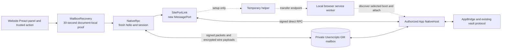
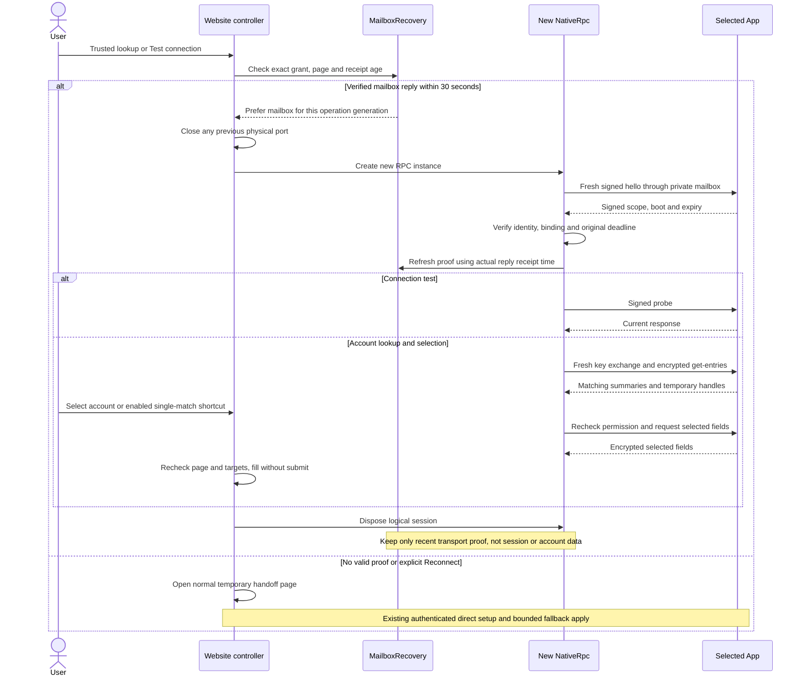
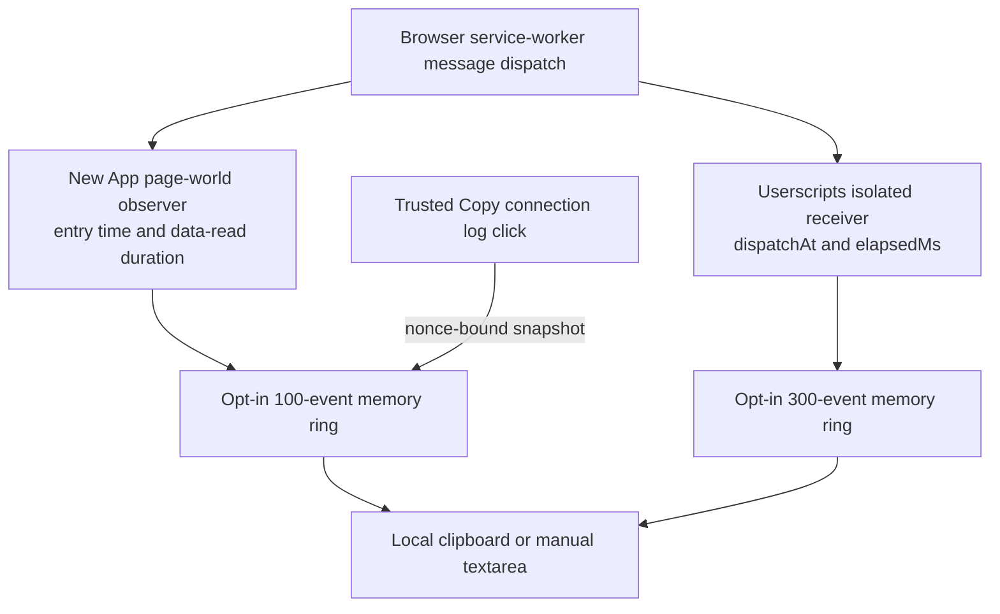

# Connect 0.6.26: keep a verified recovery route between operations

After a mailbox connection succeeded, the next trusted lookup discarded that
working transport choice and opened another temporary helper. If App discovery
was still delayed, the website re-entered the same timeout and recovery cycle.
Connect now remembers only a recently verified transport choice in the current
website document. Every operation still creates a fresh authenticated session.

This fixes a reproduced recovery loop. It does not establish the cause of the
first delayed App callback on native iOS Safari, or guarantee delivery while the
App is in the background. The updated New App provides opt-in, passive local
receiver timestamps to distinguish those remaining cases without remote logging.

## Evidence from the supplied 0.6.25 trace

| Time (UTC) | Observation | Consequence |
| --- | --- | --- |
| 06:33:55.983 | Helper reports ready for port `c7aa4e52…` | The helper loaded; authenticated App readiness has not happened. |
| 06:34:12.010 | Worker reports `app-timeout`; website starts mailbox recovery | The failure is before direct-port attachment, not account matching. |
| 06:34:26.451 | App discovery callbacks finally execute | They arrive after the worker deadline. The trace alone cannot identify the scheduling layer responsible. |
| 06:34:26.630 | Website accepts mailbox hello `28f5b965…` | A signed reply from the selected App is verified. |
| 06:34:28.515 | Website accepts probe `9a8f5795…` and displays Connected | The App answered this probe while hidden. This proves that exchange, not indefinite future liveness. |
| 06:34:32.334 | Next trusted action opens a new helper | The previous successful recovery choice was discarded. |
| 06:35:10.731 | App receives the next discovery batch when visible again | Repeating discovery reproduces the delay instead of using the just-verified route. |

Authorization remains at generation 4 through the failure. Resetting that grant,
clearing the vault, changing matching rules or increasing credential deadlines
would not address the demonstrated transition.

## Components and responsibility

| Component | Change and boundary |
| --- | --- |
| `MailboxRecovery` | Holds a copied public route, page URL, verified receipt time and operation generation in document memory. It contains no account values, encryption keys or reusable session. |
| Website controller | Normal lookup/test may use recent verified recovery. Explicit Reconnect always clears that preference and requests a direct handoff. |
| `NativeRpc` | Creates a new document/session scope and encryption negotiation for each operation. Validates the exact saved grant before and after asynchronous work. |
| Helper and local routing worker | No routing changes in this release. Existing signed readiness, boot binding, transfer ownership and close behavior remain. |
| `NativeHost` and vault protocol | Existing identity checks, one active account-selection session, URL matching, vault permissions and field checks remain. |
| Passive New App observer | Records only public discovery/handoff metadata when local logging is enabled. Never consumes a port, replies to discovery or starts service-worker messages. |

The local worker runs inside the browser. There is no remote relay server,
telemetry collector or remote debug command channel.

## Fresh-session sequence after recovery

A preferred mailbox hello uses the ordinary eight-second request budget. It does
not grant another sixty-second App-visit recovery window. Initial fallback keeps
its existing separate recovery budget. No account deadline, replay protection,
permission check or lock behavior is weakened.

## State invalidation

The retained proof must match all of: host, owner, endpoint, signing public key,
authorization revision, mailbox capability, direct-port capability and website
URL. The proof expires thirty seconds after its last actually verified reply.
A late processing task cannot turn an old receipt into fresh evidence.

| Event | Result |
| --- | --- |
| Successful normal test/fill disposal | Dispose RPC and session; recent verified transport proof may remain. |
| Current operation fails or is canceled with pending work | Drop its recovery proof. |
| Older operation completes or fails after a replacement starts | Generation fencing prevents it from changing the replacement's proof. |
| App reload/reopen publishes a different route or boot | Route refresh invalidates the old preference; old scope cannot authorize a new request. |
| Revocation, key/owner/revision change or removed route | Fail closed and discard the old route preference. |
| Website navigation, page departure or reload | Clear document-local proof and release ports. |
| Expiry or clock rollback | Discard proof. |
| Explicit Reconnect | Clear proof and attempt a fresh direct handoff. |

Authorization and the local-recording preference still persist in manager-private
storage. Neither browser restart nor a persisted grant restores an old MessagePort
or unlocked vault state.

## Local callback timing, without telemetry

The existing userscript receiver records `dispatchAt` on callback entry, before
reading event data, and `elapsedMs` for the subsequent read. The New App adds an
independent page-world observer with a maximum of 100 events. It captures the same
public discovery trace or handoff ID and the page visibility at that instant.

The observer requires the local-log opt-in attribute, checks the trusted worker
source and exact origin, never reads transferred endpoints, and clears its ring
when disabled. Snapshot messages require the same window and origin, a UUID nonce
and an exact request shape. Export filters every field again. Event text, website
addresses, vault contents and secret values are excluded. Same-origin App code
and the installed userscript remain trusted; this bridge is not a new isolation
boundary against compromised App code.

Safari clipboard export reserves its write synchronously in the click handler
using a promised Blob. If that API fails or is unavailable, the manual text export
remains available. An older App without the observer returns the ordinary script
log after a bounded snapshot wait.

If the page-world event is prompt but the matching isolated-world event is late,
the evidence locates the delay between those callbacks. If both are late, it
locates the delay before those observer callbacks. Missing records alone do not
prove suspension or a particular browser defect.

## Verification

- TypeScript check and production New App build passed.
- 667 unit tests passed, including grant changes, expired or delayed receipts,
  stale operation completion, explicit Reconnect, passive observer behavior and
  clipboard activation handling.
- The controlled browser regression drops discovery delivery while retaining the
  existing encrypted mailbox. The unchanged 0.6.25 baseline opens an extra helper
  on the next action; the candidate reuses only the verified transport choice and
  establishes a fresh authenticated session.
- Final Chromium recovery acceptance passed: two fresh-session fills after recovery
  with zero extra helpers/discovery, explicit Reconnect override, restored grant
  after App reload, and revocation before further account or credential requests.
- Existing Chromium mailbox acceptance passed: six fills after duplicate script
  injection, helper auto-close, suppressed manager notifications, cancellation of
  a pending fill, lock denial, and sanitized export correlating page-world and
  isolated-world discovery timestamps.
- Desktop WebKit App close/reopen passed: saved KDBX and grant restored without
  another consent dialog, three subsequent fills and two repeated tests. All
  eight temporary helpers closed automatically.
- All six Mermaid diagrams in this report and the architecture guide rendered successfully.

Browser acceptance uses the actual App, disposable KDBX databases and the existing
vault protocol, with a GM adapter. Desktop Chromium and WebKit do not certify the
native Userscripts extension or iOS background scheduling. The initial callback
delay and mid-operation native background stalls remain unproven as fixed.

## Upgrade

Update the existing `keewebx-connect.user.js` installation to **0.6.26**. Save
pending database edits and reload the original App and login website so both
receive the updated code. Do not rename the script, clear its storage or recreate
the vault. Existing identity and approved permissions are retained.
