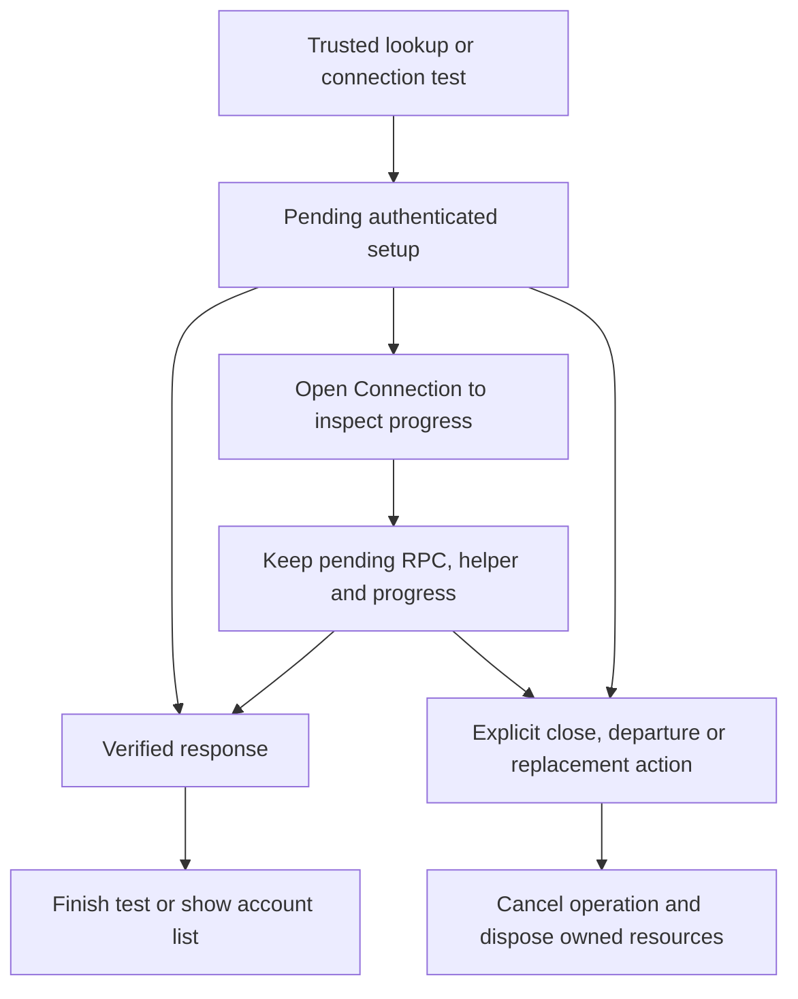

# Connect 0.6.27: inspecting connection settings must not cancel setup

Opening the Connection tab while a connection test or account lookup was pending
called the website controller's cleanup function. That canceled the operation,
closed its port/helper and replaced the progress message with ReadyToConnect.
A user returning from the helper to inspect progress could therefore stop the
connection without pressing Close or Reconnect.

The controller now preserves pending setup and its current status when inspecting
Connection. Leaving a completed account selection still disposes that selection.
Explicit panel close, navigation, changed targets and cancellation during fill
retain their existing protection. This change does not make an unavailable or
paused App execute in the background.

## What the supplied 0.6.26 logs establish

| Time (UTC) | Observation | Interpretation |
| --- | --- | --- |
| 09:09:48.194, 51.038, 53.258 | Website receives `noapp` | The worker found no eligible App client for these attempts. This is not a discovery-response timeout. |
| 09:09:56.847 | Supplied App runtime starts, initially locked | This runtime starts after the three `noapp` errors. The errors cannot be attributed to a stale port in this new runtime. |
| 09:10:25.629 | App restores authorization | The approved App becomes available without a new installation. |
| 09:10:42 and 09:10:57 | App authenticates two ports and processes multiple RPCs | These port IDs differ from the failed website attempts in the supplied excerpt. They do not prove those website attempts succeeded. |
| 09:11:11.124 and 09:11:15.457 | Website closes its pending port and returns to ReadyToConnect immediately after interaction/focus | This matches an explicit cleanup path. The old log does not record the control pressed, so it cannot prove which cleanup trigger ran. |
| 09:11:36.075–.077 | Page-world and userscript-world discovery observers record the same batch within 0–2 ms | There is no large delay between these two receiver callbacks. Both report zero data-read time. |

Authorization remains at generation 4 during the final two website attempts and
the later discovery batch. The App has no attached website ports at the end.
Clearing a stale physical port cannot by itself explain or repair delayed delivery
of the next public discovery message.

The evidence places the unexplained delay before the two receiver callbacks. It
does not distinguish a delayed worker send from delayed browser dispatch. It also
does not establish a particular Safari implementation defect. Version 0.6.26 did
not include the worker's send time or website connection ID in discovery packets.

## Corrected control flow

The fix is a guard on informational view switching, not a retry loop. No timeout,
mailbox preference lifetime, session expiry, grant check, key exchange or vault
permission is changed. A new trusted operation still cancels its predecessor.

## Local evidence added

- The worker includes the website connection ID and `sentAt` on each discovery
  probe. Retries retain the connection/trace IDs but record their actual send time.
- Both App observers retain this public metadata. Compare worker `sentAt`, page
  observer `at` and isolated receiver `dispatchAt` for the same connection and
  trace. These wall-clock timestamps are diagnostic data, never freshness proof
  or authorization inputs.
- Local UI events identify accepted actions such as Connection, panel close,
  Escape, Reconnect and loss of the login anchor. They contain fixed labels only,
  never account identifiers, field contents, control text or website addresses.
- Logging remains optional and local. The existing bounded memory rings and saved
  boolean preference remain; there is no upload or remote command facility.

Old worker messages remain accepted without timing fields. Send timing does not
alter discovery selection, reply validation or endpoint transfer.

## Verification and remaining limits

The Connection-view regression uses the real website controller, UI, RPC and
MessagePorts with a controlled remote peer and GM adapter. The previous controller
from `4d833ef` fails exactly five tab-preservation cases per engine (20/30 pass).
The candidate passes all 30 cases across Chromium and WebKit. Explicit Close,
Escape, Reconnect, URL changes, anchor loss, Save and preference changes still
cancel. This fixture does not implement credential lookup or native Userscripts.

The TypeScript check, production UI build and all 672 unit tests pass. All four
Mermaid diagrams in this report and the current architecture render successfully.

Actual-App acceptance uses the generated installer, encrypted disposable KDBX,
native App permission UI and browser-owned service-worker clients/ports:

| Engine / scenario | Result |
| --- | --- |
| Chromium, verified mailbox recovery | Repeated tests/lookups/fills use fresh signed sessions with no extra helper or discovery; explicit Reconnect opens a direct helper. |
| Chromium, App restart and revocation | New App identity invalidates recovery; the saved grant restores without injected authorization. Revocation blocks account/credential requests. |
| Chromium, dropped discovery and notification faults | Fallback fills after the App resumes; canceled fill remains empty; retry succeeds during stale-scan cleanup; locked vault denies access. |
| Chromium, local log export | Worker send time and connection/trace IDs correlate across both App observers. Export excludes URLs and fixture secrets; disabling logging clears it. |
| WebKit, actual App and website close/reopen | Saved encrypted vault and grant restore, then three fills and two repeated connection tests pass. Operations use distinct ports and helpers close automatically. |

Both browser suites use a GM adapter. WebKit substitutes a disposable local HTTPS
origin for the production origin. The separate cancellation fixture uses a mock
remote peer, as described above. None is a native iPhone Userscripts execution.

The user's native Safari close/reopen and background delivery failure is **not
claimed fully fixed** by this patch. Desktop Chromium/WebKit with a GM adapter
cannot certify native Userscripts scheduling. The supplied paired observers are
stronger evidence than a successful desktop-only test, but do not provide the
missing worker send timestamp for these historical attempts.

An automatic switch to the old App is not used as an assumed recovery mechanism.
Existing browser acceptance observed native refusal of `WindowClient.focus()`;
the [API requires activation](https://developer.mozilla.org/en-US/docs/Web/API/WindowClient/focus),
and a method being present does not prove that a particular call is permitted.
No replacement App is opened or navigated by this fix.
