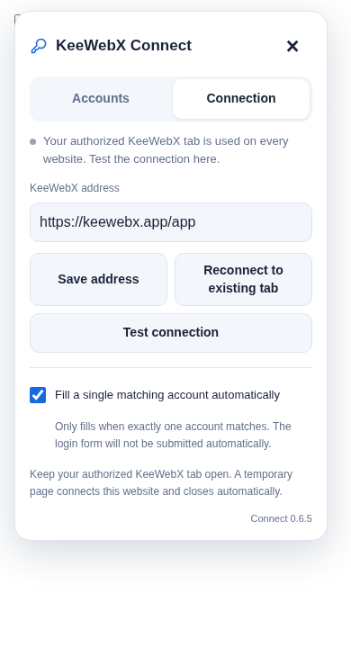

# Connect 0.6.5: reusable Preact UI and login-field controls

[Safari installer](https://keewebx.app/connect-port/keewebx-connect.user.js?v=0.6.5)
· [Setup](../README.md)
· [Shared component contract](../../../ui-kit/src/connect/README.md)

## User-facing changes

- A key appears only beside a recognized visible login field. Search, newsletter,
  contact, verification-code and new-password fields do not activate it. Opening,
  hiding or removing a dynamic login form updates the launcher.
- Connection settings include **Fill a single matching account automatically**.
  It is off by default and saved privately. When enabled, a trusted account
  request with exactly one match goes directly through the existing guarded
  fill operation. Multiple matches remain a choice. Page load alone never fills,
  and the form is never submitted automatically.
- The panel uses consistent shared Preact buttons, account rows, preferences,
  connection status and diagnostics, including phone and keyboard-sized layouts.

## Reuse and host boundaries

The view components live in `modules/ui-kit/src/connect` and use only Preact and
TypeScript. They accept typed state, account summaries and callbacks. They can
be embedded in an extension page without GM, a Userscript runtime or a transport.
Styles are scoped for both ordinary DOM and Shadow DOM embedding.

GM preferences, trusted-event handling, login-field detection and popup placement
belong to the Userscript adapter. The preference interface is independent of its
storage implementation. Signing identities, URL matching, encryption, App-side
permissions and the direct MessagePort protocol use the existing implementation.

Single-match filling calls the same selection operation as an explicit account
click. It reuses the lookup's original aggregate deadline and rechecks current
App selection, vault permission, website scope and field identity before filling.
The setting does not permit background or page-load credential requests.
Synthetic focus events do not seed a selected field, and lookup revalidates the
current detected field before opening a helper or requesting accounts. A real
click-capture regression changes a cached form into a newsletter and verifies
zero helpers, account requests and field requests.

## Validation

| Check | Completed result |
|---|---|
| Existing transport, lifecycle, signing, receipt and website-policy unit cases | 338 passed |
| Actual login-field adapter in Chromium and WebKit | 56 passed |
| Existing fill-destination browser guards | 14 passed |
| Shared Preact components in ordinary DOM and Shadow DOM, Chromium and WebKit | 192 passed |
| Chromium isolated-world real-KDBX E2E, with App GM reads and remote helper close blocked | 26 passed |
| WebKit isolated-world real-KDBX E2E, with remote helper close blocked | 15 passed |
| New website UI with exact existing 0.6.4 App userscript | 26 passed |
| Userscript typecheck, package boundaries and App build | Passed |

Both production-installer suites cover the saved checkbox across reload, one
account filling without an account-row click, two matches requiring selection,
opt-out restoring manual choice, and a launcher that follows login-form visibility.
They also retain the prior 24 alternating fills, 20 injected losses and four
cancellation recoveries on the original App and physical ports. No form is submitted.
The Chromium audit verifies 3,173 signed envelopes and 1,682 encrypted sensitive
envelopes without plaintext transport. The port and native permission checks still
precede credential access.

Screenshots cover 320/390-pixel panels and resized desktop viewports representing
keyboard space. Those checks do not certify a physical iPhone keyboard or native
Userscripts execution. Device acceptance remains separate from desktop WebKit.

Bun produces a self-contained installer with Preact's MIT notice. The published
installer and actual production assets are verified separately during release.

## CI driver follow-up

A WebKit CI run exposed an invalid driver assumption: its repeated-lookup helper
always clicked the underlying username field even when the settings panel covered
that field. A controlled 480-pixel viewport reproduced the same 30-second lookup
failure before any new account request was sent.

Both browser drivers now use Accounts and Find accounts when the panel is open;
only a closed panel requires a field click followed by the key. An explicit
occlusion case verifies that a covered field does not prevent lookup and selected
fill through the visible panel controls. All 15 WebKit cases pass with that
regression included. The product installer is unchanged by this test follow-up.
