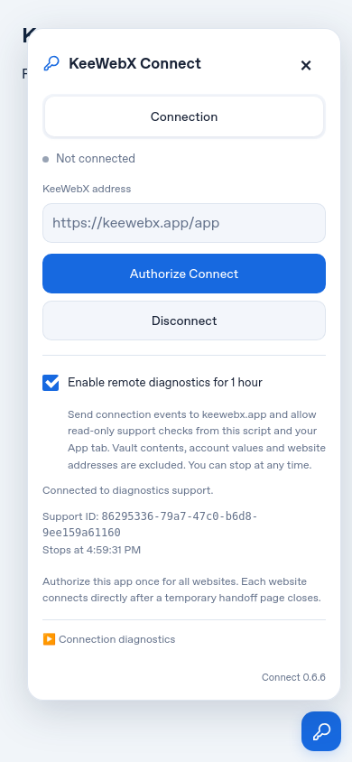
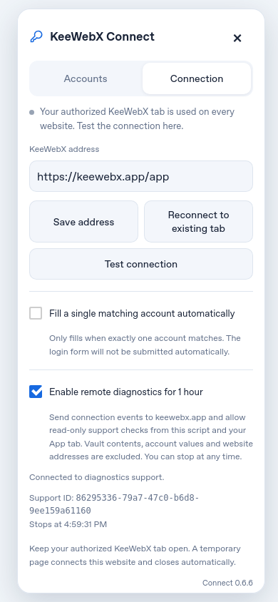

# Connect 0.6.6: optional remote diagnostics and reconnect recovery

[Safari installer](https://keewebx.app/connect-port/keewebx-connect.user.js?v=0.6.6)
· [Setup](../README.md)
· [Diagnostic scope and command contract](remote-diagnostics.md)

## User-facing behavior

**Connection → Enable remote diagnostics for 1 hour** creates a temporary
support session shared by the App and website script instances. The panel shows
its support ID, upload status and automatic stop time. Support can correlate
fixed connection events and request reviewed read-only checks through the
hosted Worker. The default is off; turning it off stops collection and removes
the shared opt-in. An in-progress enable can also be canceled.

The report separates website actions, the App's Userscript receiver, the main
App connector and the discovery worker. Raw logs, exception text, URLs, database
names, account values, passwords, ciphertext and private signing keys are
excluded by explicit allowlists on both client and server. Public upload
credentials cannot read reports or issue commands. There is no remote code
execution or credential-access command.

The pure TypeScript diagnostic client has injected storage, HTTP and safe-state
adapters. The Preact view is shared with future extension hosts; GM APIs remain
in the Userscript adapter. This feature does not route credential traffic
through the diagnostic service.

## Connect recovery

After a vault is locked, the application announces its access state independently
of the per-request bridge that locking resets. Unlocking resumes the existing
Connect authorization while old credential operations and account handles stay
invalid. Explicit disconnect remains disconnected.

A lost discovery acknowledgement previously exhausted the worker's single probe
even though the App panel reported that it had posted a reply. Discovery now
tries up to four fresh channels within the same eight-second deadline. A broken
probe cannot cancel a later healthy one, and the website's credential transport
port transfers once. Receiver selection, signed ready receipts and the encrypted
protocol still gate access.

The hosted worker follow-up retains the same pending connection for one more
discovery round when the first round times out. Total discovery remains bounded
to 16 seconds, within the existing website operation deadline. Explicit disabled
or address-mismatch replies fail immediately. A selected App that resumes after
the initial eight seconds can answer the new round without another helper or
App tab. This server asset update also works with the installed 0.6.6 script.

A real-KDBX browser regression holds App replies for 10.5 seconds. The previous
worker fails; the follow-up completes the lookup and fill with the same helper,
one port transfer and the original App. All 29 Chromium acceptance steps and 27
worker unit cases pass with that recovery included.

The browser regression enables a virtual PRF passkey, locks and unlocks the real
encrypted fixture database, and reconnects to the original App. A separate
injected lost-discovery-reply case reproduces the reported timeout and verifies
recovery. This establishes recovery from that modeled failure; it does not
identify Safari's exact internal reason for dropping a message on the user's
device.

## Acceptance

| Check | Result |
|---|---|
| Pure diagnostic client, schema and real GM HTTP adapter | 55 passed |
| Built-installer diagnostic browser cases, Chromium/WebKit with callback/Promise adapters | 60 passed |
| Shared components in ordinary and Shadow DOM | 216 passed |
| Cloud diagnostic backend and private operations | 78 passed, typecheck passed |
| Real-KDBX Chromium MessagePort acceptance | 28 passed, including passkey lock/unlock and a lost discovery reply |
| Real-KDBX WebKit MessagePort acceptance | 15 passed |
| Production support workflow | KV list/read/write, command delivery and result readback passed |

- The diagnostic core and HTTP adapter cover opt-in, expiry, cancellation,
  redaction, bounded commands, stale responses, cross-document revocation and
  mixed event/result batching.
- Shared Preact components are checked in ordinary DOM and Shadow DOM across
  Chromium and WebKit, phone widths, reduced viewport space and both themes.
- Browser diagnostic acceptance exercises the built installer, App and website
  instances, trusted toggles, callback and abortable-Promise HTTP adapters,
  command/result correlation, malformed commands, offline failures and stopping.
- The production Worker and private support tooling have completed an actual
  synthetic ingress → authenticated read → queued check → result readback.
- Existing real-KDBX MessagePort checks retain account filling, reply-loss
  recovery, cancellation, revocation and helper closure coverage.

All browser results distinguish desktop engines and a simulated manager from
physical iOS acceptance. Native Safari device diagnosis requires enabling the
updated script in the original App and the failing website. The paused standalone
Home Screen PWA investigation is not part of this release.
