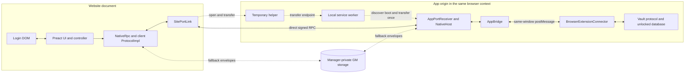
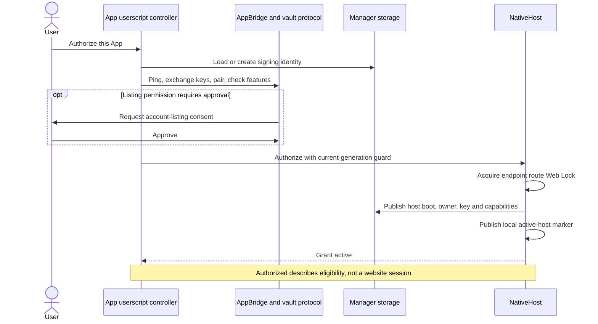
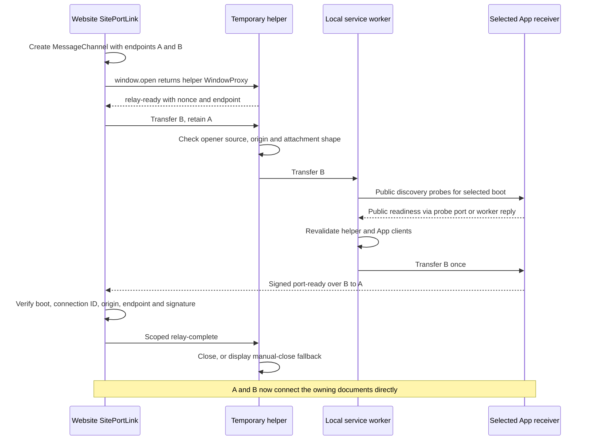
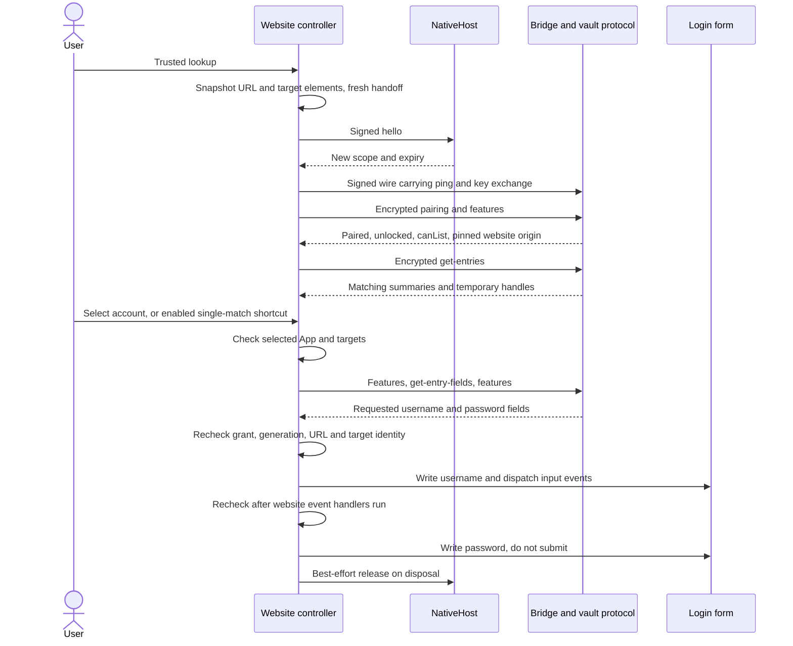
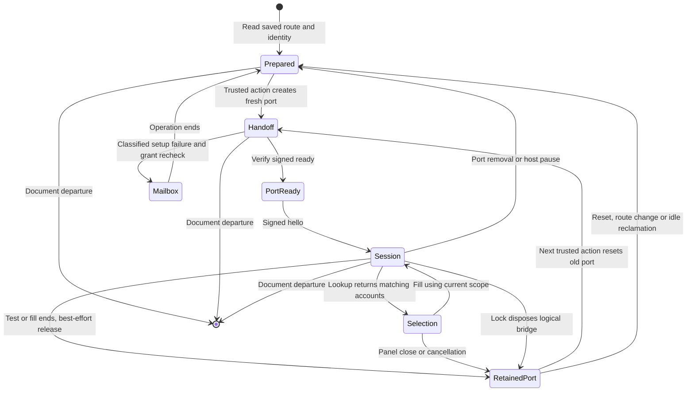
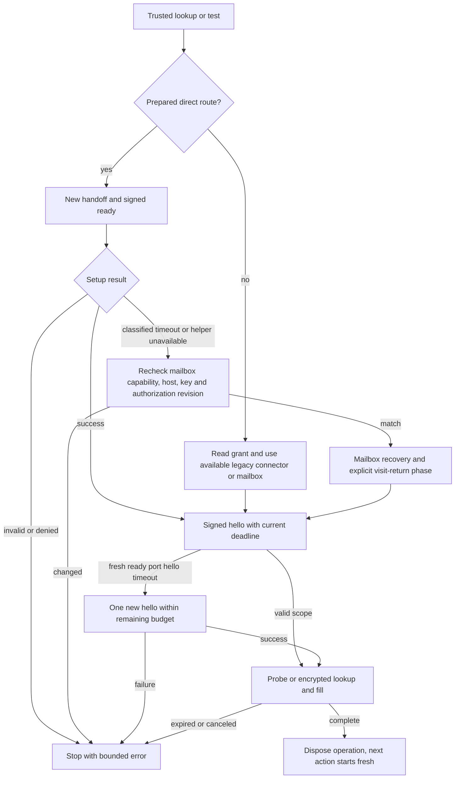
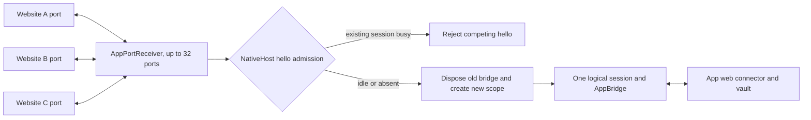
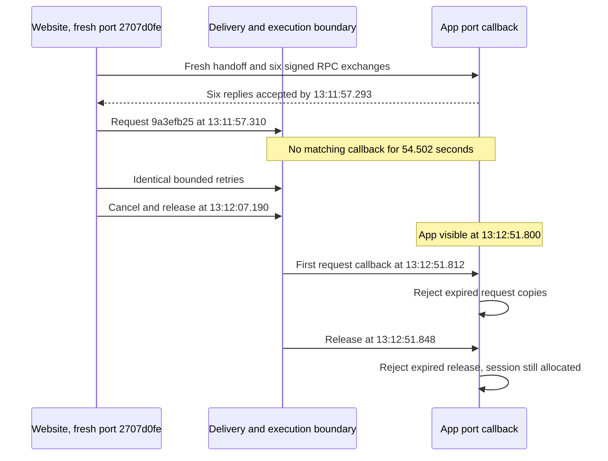
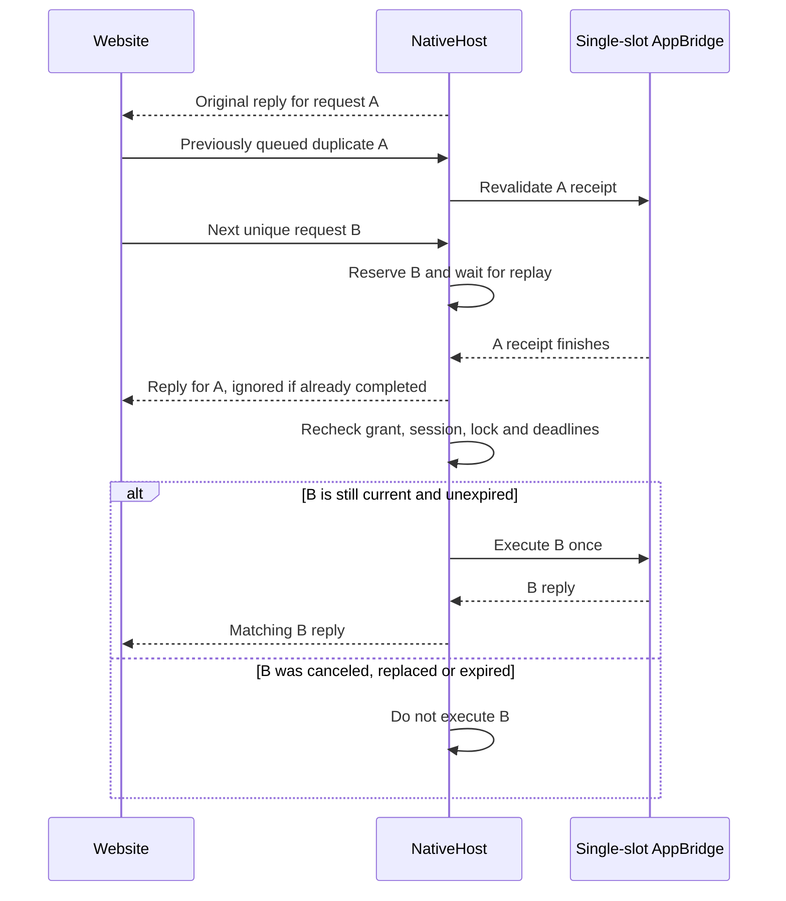

# KeeWebX Connect 0.6.21: technical analysis

This report describes tag **`userscript-v0.6.21`**, commit **`5b7eb275f0d7e0e4172debd1295e2077c296cffb`**. Source links below are pinned to that commit. The final sections distinguish subsequent lifecycle and receipt-ordering changes from that snapshot.

**Finding:** 0.6.21 creates a fresh physical port for each trusted query or connection test, but this does not resolve every connection failure. In the supplied native iOS trace, a newly authenticated port carried six successful signed RPC exchanges before the next request waited **54.502 seconds** to enter the App's port callback. The App became visible immediately before delivery resumed. The trace localizes that delay to the path between website transmission and App callback execution. It does not identify the underlying browser or userscript execution-world cause.

Closing and refreshing should invalidate temporary communication state. Authorization and preferences can survive. Those two requirements are compatible: keep the durable approval, create a new runtime identity, and reject messages belonging to the old runtime. Cleanup improves lifecycle correctness, but it cannot itself prove or guarantee prompt background message delivery.

## 1. Components and responsibility boundaries

The [installer build](https://github.com/gynet/keewebx/blob/5b7eb275f0d7e0e4172debd1295e2077c296cffb/modules/extension/userscript/build-connect.ts) bundles the `simple-connect.ts` entry point with Bun, TypeScript, Preact and TweetNaCl. Its metadata requests top-level HTTPS documents, `document-idle`, content-world injection, and manager storage/tab APIs. The actual isolation and execution semantics depend on the script manager. A desktop test adapter does not reproduce every native Userscripts behavior.

| Component and pinned source | Responsibility | Important boundary |
| --- | --- | --- |
| [Website and App controller](https://github.com/gynet/keewebx/blob/5b7eb275f0d7e0e4172debd1295e2077c296cffb/modules/extension/userscript/src/simple-connect.ts) | Detect runtime role, authorize/restore the App, coordinate trusted actions and cancellation | UI state is not proof of a live transport |
| [ConnectUI](https://github.com/gynet/keewebx/blob/5b7eb275f0d7e0e4172debd1295e2077c296cffb/modules/extension/userscript/src/connect-ui.ts) and [shared components](https://github.com/gynet/keewebx/tree/5b7eb275f0d7e0e4172debd1295e2077c296cffb/modules/ui-kit/src/connect) | Preact panel, account choices, settings and status | Closed shadow DOM isolates presentation, not security |
| [Login-field detection](https://github.com/gynet/keewebx/blob/5b7eb275f0d7e0e4172debd1295e2077c296cffb/modules/extension/userscript/src/login-fields.ts) | Observe eligible, visible login inputs | Detection does not initiate a connection or read credentials |
| [Form targets](https://github.com/gynet/keewebx/blob/5b7eb275f0d7e0e4172debd1295e2077c296cffb/modules/extension/userscript/src/form-targets.ts) | Snapshot and revalidate destination fields, write values | Navigation or replacement of fields stops filling |
| [Operation](https://github.com/gynet/keewebx/blob/5b7eb275f0d7e0e4172debd1295e2077c296cffb/modules/extension/userscript/src/operation.ts) | Bound a UI operation, cancel promises, track its stage | Timers do not force a suspended document to run |
| [NativeRpc / NativeHost / route preparation](https://github.com/gynet/keewebx/blob/5b7eb275f0d7e0e4172debd1295e2077c296cffb/modules/extension/userscript/src/native-connect.ts) | Signed RPC, selected App grant, logical session, transport choice | This is the `NativeRpc` used by the production entry point |
| [SitePortLink / AppPortReceiver](https://github.com/gynet/keewebx/blob/5b7eb275f0d7e0e4172debd1295e2077c296cffb/modules/extension/userscript/src/direct-ports.ts) | Own physical MessagePorts, transfer admission, ready proof, cleanup | A port object is a transferable capability, not a serializable tab ID |
| [Temporary helper](https://github.com/gynet/keewebx/blob/5b7eb275f0d7e0e4172debd1295e2077c296cffb/modules/ui/connect-port/relay.js) | Validate opener and transfer an endpoint to the local worker | Closes after website verification of signed App readiness |
| [Local service worker](https://github.com/gynet/keewebx/blob/5b7eb275f0d7e0e4172debd1295e2077c296cffb/modules/ui/connect-port/worker.js) | Discover the selected App boot and transfer the endpoint once | No credential RPC server, fetch handler or established-port registry |
| [AppBridge](https://github.com/gynet/keewebx/blob/5b7eb275f0d7e0e4172debd1295e2077c296cffb/modules/extension/userscript/src/app-bridge.ts) | Same-window `postMessage` adapter into the existing App protocol | Allows six actions and pins the website origin |
| [Client ProtocolImpl](https://github.com/gynet/keewebx/blob/5b7eb275f0d7e0e4172debd1295e2077c296cffb/modules/extension/src/background/protocol/protocol-impl.ts) | Key exchange, pairing, encrypted feature/list/field calls | Separate from outer signed transport RPC |
| [BrowserExtensionConnector](https://github.com/gynet/keewebx/blob/5b7eb275f0d7e0e4172debd1295e2077c296cffb/modules/vault/src/comp/extension/browser-extension-connector.ts) | App-side request queue, connection generations and execution receipts | Late responses cannot publish into a replacement connection |
| [Vault ProtocolImpl](https://github.com/gynet/keewebx/blob/5b7eb275f0d7e0e4172debd1295e2077c296cffb/modules/vault/src/comp/extension/protocol-impl.ts) | Decrypt requests, enforce permissions, resolve handles and read fields | The App remains authoritative for access and matching |
| [Website matching](https://github.com/gynet/keewebx/blob/5b7eb275f0d7e0e4172debd1295e2077c296cffb/modules/vault/src/comp/extension/website-matching.ts) | Compare authoritative destination against stored entry URLs | Does not trust a caller-supplied search scope |
| [ConnectMailbox](https://github.com/gynet/keewebx/blob/5b7eb275f0d7e0e4172debd1295e2077c296cffb/modules/extension/userscript/src/connect-mailbox.ts) | Optional signed-envelope transport through manager-private storage | Still needs both runtimes to execute |
| [ReplyReceipt](https://github.com/gynet/keewebx/blob/5b7eb275f0d7e0e4172debd1295e2077c296cffb/modules/extension/userscript/src/reply-receipt.ts) | Bind the latest receipt to request, port, generation, key and deadline | Duplicate delivery does not authorize arbitrary re-execution |
| [AppInstance](https://github.com/gynet/keewebx/blob/5b7eb275f0d7e0e4172debd1295e2077c296cffb/modules/ui/src/app-instance.ts) | Use a browser Web Lock to elect the primary New App runtime | Does not discover or wake the App for Connect |
| [Local connection log](https://github.com/gynet/keewebx/blob/5b7eb275f0d7e0e4172debd1295e2077c296cffb/modules/extension/userscript/src/local-connect-log.tsx) | Optional sanitized in-memory events and manual copying | No remote upload, latest 300 events per tab |

Dashed edges are setup or fallback paths. After handoff, direct account traffic bypasses the helper and worker. The worker runs inside the browser, with scope `/connect-port/`. It enumerates same-origin window clients using `includeUncontrolled: true`, permitting discovery of the App outside its control scope. It cannot enumerate arbitrary websites or obtain arbitrary `WindowProxy` references for them.

## 2. Setup, authorization and discovery

Authorization first talks to the vault through an App-local bridge: ping, key exchange, pairing, feature checks and, when explicitly requested, listing consent. The App must be unlocked and listing must be approved before it publishes a selected route. Publication uses a separate exclusive Web Lock for that endpoint and fences canceled attempts. The GM route write precedes the App-origin active-host marker.

Silent restoration repeats eligibility and permission checks. Explicit disconnect stores a restoration block. A new primary New App may inherit the prior selected grant with the same signing identity, but its boot ID is new. Optional manager tab APIs provide owner continuity in other cases. Neither restoration nor Passkey unlock recreates a departed document's MessagePort or protocol session.

On a website, `prepareDirect()` reads the saved route and signing identity before the user action. Route-read revisions prevent a late read from replacing newer state. The trusted action calls `openDirect(endpoint, true)` synchronously, before awaiting work, to preserve browser popup activation. In 0.6.21 both lookup and test replace the previous physical port. Account selection and fill within that lookup retain the new session.

Opening the key panel starts lookup when a valid field was selected, or a connection test when a qualifying field was detected but no valid selection exists. Form detection and page load do not perform this handshake automatically.

## 3. Port ownership and helper closure

`connectionId`, `appBoot`, nonce and document IDs are matching values, not substitutes for a live port. A closed MessagePort cannot be recovered from JSON. Reload requires a new endpoint transfer.

Temporary discovery channels are distinct from the website's credential channel. Discovery retries create fresh probe endpoints, not multiple transfers of the website endpoint. The App coordinator routes an incoming transfer to one receiver, avoiding competing listeners consuming or closing the same endpoint.

The helper closes after signed **port readiness**, before logical `hello` and vault negotiation finish. Closure does not mean credentials are ready. A retained helper reference after a failed close is used with scoped messages containing the original nonce, connection ID and endpoint, rather than blindly navigating or closing a potentially changed window.

## 4. Connection test versus lookup and fill

| Stage | Work performed | What success establishes |
| --- | --- | --- |
| Signed port-ready | Authenticate transferred channel identity | The selected runtime answered setup at that time |
| Outer `hello` | Allocate one scope, App boot and 120-second expiry | A logical session was admitted |
| Outer `probe` | Return App visibility and boot | A signed host response, not a vault query |
| Lookup | Inner ping, key exchange, pair, features, get entries | Vault protocol and listing access worked for this origin |
| Fill | Recheck grant and features, retrieve fields by handle, recheck access and targets | The selected values can be written to the still-valid destination |

The UI shows up to ten suggestions. Automatic single-account fill requires the option to be enabled and the **full** suggested list to contain exactly one entry. The App returns summaries such as title, username, URL and icon, which are potentially sensitive metadata, but not password or OTP values. Field values are requested separately.

Matching belongs to the App. A website-scoped request cannot enumerate another site's accounts by changing encrypted `url` or `query` parameters. Matching checks primary and additional entry URLs, hostname and port, with a restricted leading `www.` equivalence. It is not arbitrary subdomain or suffix matching, and URL paths do not distinguish accounts.

Fill deliberately exposes values to the destination website DOM. Connect does not submit the form, although website handlers can react to input/change events. A successful connection test does not certify any of this full sequence, and its Connected label is only a last-check snapshot.

## 5. State, generations and persistence

| Identity or generation | Owner and purpose | Invalidated or replaced by |
| --- | --- | --- |
| Signing identity | Manager-private long-lived Ed25519 identity | Explicit identity replacement or storage loss |
| App boot (`host`) | One `NativeHost` instance | New App document/runtime |
| App owner | Optional manager tab identity, used for restoration eligibility | New owner or unavailable tab continuity |
| `authorization` | Host authorization-attempt and lifecycle fence | Authorize attempt or pause, with additional failed-attempt fencing |
| `publishedAuthorization` | Revision of the route actually published | Successful route publication |
| UI operation generation | Stop old continuations affecting current UI or fill | Cleanup, cancellation, replacement operation |
| Route-read revision | Reject obsolete asynchronous GM reads | New read, grant invalidation, document departure |
| Port generation and connection ID | Match physical-link ownership | Reset or new physical channel |
| RPC `document`, `id`, `scope` | Bind a request and logical session | New RPC client, request or hello respectively |
| `kwConnection`, `kwRequest`, `kwAttempt` | Inner bridge identity, logical execution and receipt attempt | Bridge reset, new execution or receipt replay |
| Vault access epoch and client generation | Fence database and permission changes | Access suspension, protocol client invalidation or replacement |

The diagnostic authorization counter is not a count of user approvals. An increment alone does not prove an unexpected reauthorization. Conversely, an unchanged counter is not proof that a port is delivering messages. In the reported fresh-port stall, the counter remained **3**.

| Storage location | Contents | Intended lifetime |
| --- | --- | --- |
| Manager-private GM values | Public and secret signing keys, endpoint, selected route and capabilities, auto-fill preference, local-log enabled flag | Across reloads and tabs |
| Optional GM tab data | App owner and legacy website routing ID | Tab continuity provided by the manager |
| App-origin localStorage | Public active-host marker, explicit-disconnect restoration block, launcher position | Across documents until changed or cleared |
| App settings/runtime data | Pairing identity approvals and permissions | Separate from transport and manager route state |
| GM mailbox records | Temporary signed envelopes, encrypted wire bodies and wake hints | Until completion, cancellation or expiry cleanup, deletion best effort |
| Website memory | Port, helper reference, pending requests, scope, box keys, account list and target references | Current document/operation |
| App memory | Boot, grant snapshot, ports, logical session/bridge, replay receipts and entry handles | Current runtime and valid session/access epoch |
| Local logs | Latest 300 sanitized events | Current tab memory, cleared on reload or logging off |

The local logging **preference** persists. The log contents do not. Browser-managed storage lifetime is not a guarantee of secure erasure or immediate removal of abandoned mailbox records. Message acceptance must therefore depend on signatures, ownership, current access and deadlines, not on successful deletion alone.

## 6. Lifecycle and reset behavior in 0.6.21

The diagram's release transitions describe the website's local disposition. App-side release is best effort and may not run before its deadline.

| Event | Implemented behavior | Limit or remaining state |
| --- | --- | --- |
| New trusted lookup/test | Cancel prior UI work and force a new physical handoff | Fresh ports do not guarantee subsequent callback scheduling |
| Panel close, canceled operation, completed test/fill | Stop local work and dispose the RPC client, send signed release if scoped | A previously authenticated physical port is retained in 0.6.21 |
| Website `pagehide` | Reset direct link, fence route reads, cancel operation and stop field observation | Departure events are not guaranteed during abrupt termination |
| Website BFCache return | Clear prior UI work, restart detection and foreground preparation | Does not resume old account handles or logical scope |
| Website becomes hidden | Preserve pending setup/lookup, cancel displayed selection or active fill | Visibility is not a reliable indication of execution progress |
| App database lock | Dispose logical session/bridge and invalidate vault access | Physical ports and durable authorization may remain |
| App unlock | Resume eligible grant, never restore the old locked scope | Passkey success does not establish Connect liveness |
| App cached `pagehide` | Pause host, increment host fence, clear ports/session | Main App primary Web Lock can remain held while cached |
| App ordinary `pagehide` | Revoke runtime without marking explicit disconnect | Async route cleanup may not finish before departure |
| App close/reload/reopen | New runtime creates new boot ID, restoration republishes if eligible | Other tabs may temporarily hold old route metadata |
| Explicit disconnect | Pause, clear keys/ports/session, store restoration block, remove owned route | Failed storage deletion must not revive that runtime |
| Lost peer or expired scope | Reject invalid work, later reset/replacement/idle cleanup reclaims state | Scope expiry alone is not an immediate memory-disposal timer |

**Required state policy:** persist signing identity, authorization preferences and user settings. Discard old port/window references, pending requests, logical sessions, ephemeral box keys, lists and handles when their owning operation or document ends. Retain a list only while its own valid selection operation needs it. Never persist an unlocked vault or field values merely to recover a transport.

Graceful cleanup and crash recovery are different. A tab can be killed without `pagehide`. The remaining peer must reject old identities, expired requests and late callbacks even if no close message arrives. A new boot must not inherit old ports by copying their IDs. Web Locks can coordinate eligible primary ownership in a shared browser storage context, but do not force a stopped page to execute, prevent opening a second tab, or establish Safari-to-standalone-PWA connectivity.

### The concrete release gap

`NativeRpc.dispose()` in this snapshot cancels pending local promises and sends a best-effort signed `release` with a **3-second** deadline. It resets unauthenticated setup, but retains a port that has delivered an authenticated RPC reply. `NativeHost.receive()` rejects expired packets before its release handler. An expired release therefore cannot dispose the App session. The session may remain until replacement hello, lock, pause, matching port removal or later reclamation. Access expiry and memory cleanup are separate facts.

`SitePortLink.reset()` already posts a port-bound close message and closes its local endpoints. The App's matching-port removal callback clears the matching logical session. This existing mechanism is relevant to lifecycle cleanup without weakening signed-request deadlines. It still requires the App callback to run before remote memory can be reclaimed through that message.

## 7. Recovery paths, retry bounds and timers

There is no general mid-operation switch that safely replays every failed credential request. The low-level compatibility path can abandon a previously successful reused port after a 3-second hello timeout and try mailbox; the 0.6.21 UI's fresh-operation policy normally bypasses that reuse path. Fallback choice is not persisted as a permanent preference.

| Budget or bound | Value | Scope and consequence |
| --- | --- | --- |
| Standard bounded GM call | 5 s | Caller timeout does not cancel underlying manager work |
| Helper worker readiness / announcement | 8 s / 12 s | Different phases, not a guaranteed total setup duration |
| Worker discovery | Up to 16 s | Up to two probe rounds, each at most 8 s |
| Probe attempts | At most 4 per round/candidate | Retry delays start at 750 ms and increase exponentially |
| Website port setup / worker handoff budget | 25 s each | Separate clocks with validation on receipt |
| Lookup or manual selection operation | 30 s | Auto-fill within lookup shares that lookup budget |
| Connection test | 35 s initially | After explicit mailbox return, final probe has a 5 s budget |
| Fresh direct hello | 8 s per attempt, bounded by operation | One additional hello may be attempted after a timeout |
| Explicit mailbox visit-return phase | 60 s | Lookup then starts a fresh 30 s work budget |
| Wire RPC | Up to 15 s | Also constrained by remaining operation and scope lifetime |
| Identical direct hello/receipted-wire retry | 750 ms | Same signed envelope and original deadline |
| AppBridge receipted-request retry | 750 ms | Same logical execution, receipt validation required |
| Logical session | 120 s from hello | No automatic timer-based bridge disposal at expiry |
| Best-effort release | 3 s | Late release is rejected |
| Entry handle ceiling | 5 min | Earlier session, access, origin or object invalidation still wins |
| Physical port idle reclamation | 10 min, sweep every 30 s | Sweep itself depends on App execution |
| Mailbox wake / reply / pending scan | 1500 / 100 / 150 ms | Manager events and page return also trigger reads |
| Resource caps | 32 App ports, 8 worker setups, 32 candidate windows, 1024 consumed request IDs | Bounds allocation and replay bookkeeping |

These values are source limits, not additive latency guarantees. `Date.now()` checks reject work that expired while timers or callbacks were delayed. Extending a timeout changes acceptance duration, not whether a document executes. Settings load/save are exceptions to the general bounded-GM wrapper in this snapshot and can remain pending if the manager promise never settles.

## 8. Multiple websites and one App

Multiple physical channels do **not** imply independent concurrent account sessions. A new hello can replace an idle session belonging to another website, including a session created by a connection test. If the existing session is busy, the hello fails rather than running concurrently. An account list on another website can consequently become stale and require a new lookup. Port removal is associated with its matching session, not a blanket right to destroy an unrelated newer session.

The primary App Web Lock and route-publication Web Lock solve different problems. The former gates primary runtime ownership. The latter serializes publication and cleanup of the selected Connect route. Neither is an RPC queue, heartbeat or wake mechanism. Discovery still asks for the saved App boot and must observe an acknowledgement from the corresponding receiver.

## 9. Security model and trust boundaries

1. **Manager isolation:** the installed userscript and manager are trusted. The persistent Ed25519 secret is shared by this script's App and website runtimes through private GM storage. It is not an App-only private key. Ordinary website code must not have access to this storage or execution world.
2. **Port admission:** helper messages bind browser-observed opener/source and origin. Worker handoff validates browser-owned clients and the selected boot. Signed port readiness binds `appBoot`, `connectionId`, endpoint and site origin under a separate `keewebx-connect-port-ready-v1` signature domain.
3. **Outer RPC:** canonical signed packets bind host, endpoint, request ID, RPC document ID, origin, operation, scope and deadline. The direct receiver compares packet origin with the transferred port's admitted origin. Replies must match a pending request. A late valid signature is insufficient after expiration or cancellation.
4. **Inner confidentiality:** fresh TweetNaCl box keys protect credential protocol payloads. Pairing signs both session public keys under `kwx-pair-v1`. Outer routing metadata and initial ping/key exchange are not confidential. Same-origin App code remains trusted, and this review is not a complete cryptographic audit.
5. **Vault authority:** the bridge permits `ping`, `change-public-keys`, `kwx-pair`, `kwx-features`, `kwx-get-entries` and `kwx-get-entry-fields`. The App checks pairing, permission, allowed files, pinned website origin and current access epoch. Handles bind origin, client generation, file/database/entry identity and expiry. Field reads and response publication recheck access.
6. **Retry safety:** a duplicate request can recover a matching receipt, not freely execute another read. Receipt bindings include canonical request, original port, authorization generation, key object and deadline. The App connector also fences logical execution and revalidates responses before publication.
7. **Fallback boundary:** mailbox transport has no browser-observed remote window peer. It relies on signed messages from the trusted userscript runtime. It stores encrypted wire envelopes, not an unlocked vault. Best-effort deletion is not an acceptance check.

Neither same-window messages nor closed shadow DOM protect against compromised App-origin code. Successful field filling intentionally makes credential text available to the target website. Authorizing one userscript identity for all websites therefore depends on strict App-side origin matching, not on trusting each website to request only its own accounts.

## 10. Paired native iOS evidence: a fresh port stalls

The following is a correlation of the supplied 0.6.21 website and App logs. IDs are abbreviated for readability. Timestamps are copied as supplied and interpreted as same-device wall-clock observations, not profiler measurements.

| Time | Website observation | App observation / interpretation |
| --- | --- | --- |
| 13:11:21.721–38.118 | Port `03335434` opens, helper becomes ready, discovery later times out | No timely acknowledgement for that attempt |
| 13:11:38.233 | Mailbox request `c92d8aea` starts | This attempt is subsequently canceled by the user |
| 13:11:41.336–49.435 | Port `120d0bdd` opens and eventually completes hello/probe | App becomes visible at 49.395 and processes queued discovery work |
| 13:11:56.106 | Old `120d0bdd` port is closed | Confirms the following attempt is not old-port reuse |
| 13:11:56.947 | Fresh `2707d0fe` has authenticated port-ready | Matching fresh receiver is established |
| 13:11:56.947–57.293 | Six signed RPC replies are accepted | Matching requests and replies execute promptly through 57.284 |
| **13:11:57.310** | Seventh request `9a3efb25` is sent, posted at 57.312 | No corresponding App `port-message` yet |
| 13:11:58.063–13:12:07.077 | Identical request is posted repeatedly | No prompt receive callback appears |
| **13:12:07.190** | User cancellation, best-effort release `e3f2fd16` posted | Release has its own short deadline |
| **13:12:51.800** | — | App is visible |
| **13:12:51.812** | — | First callback for `9a3efb25`, **54.502 s after send** |
| 13:12:51.817–51.848 | — | Queued copies are rejected as expired |
| **13:12:51.848–51.850** | — | Release arrives and is also rejected as expired |
| Through 13:13:05 | — | `hasSession:true`, `ports:1`, authorization generation remains **3** |

**Established:** setup can succeed and delivery can later stall within the same operation. For this seventh request the delay precedes the receiver's `port-message` instrumentation, so it is not time spent inside that request's vault query. A new physical port and an unchanged authorization generation did not prevent the failure. Rejecting the expired copies is correct.

**Not established:** the logs do not identify whether native Safari scheduling, userscript isolated-world dispatch, or another pre-callback condition caused the delay. The visibility correlation supports a lifecycle investigation but is not a complete cause. The logs omit RPC action, so the seventh request must not be labeled as a particular feature, list or field call. Earlier successful background tests do not prove this later state will behave identically.

The retained session after cancellation is a separate cleanup finding. At the end of the supplied excerpt the approximately two-minute session lifetime had not yet elapsed. The trace therefore demonstrates an expired release and retained allocation, not acceptance of an expired credential request or proof of unlimited session access.

## 11. Reading failures and local logs

| Observable event or symptom | What it supports | What it does not establish |
| --- | --- | --- |
| `relay-opened` / `relay-ready` | Helper opened and communicated with its opener | App discovery, authorization or vault readiness |
| `discovery-received` / `discovery-sent` | App handler ran and posted public status | Worker received it before its deadline |
| `port-ready` with `matched` on website | Website verified signed readiness on the new port | Logical session or account query success |
| Website `rpc-sent` / `port-posted` | Request scheduled and `postMessage` invoked without synchronous failure | Peer callback execution or receipt |
| App `port-message` | Receiver callback began | Signature, deadline, scope or vault permission acceptance |
| App `rpc-received` | Packet passed initial signed-request and shape checks | Later selected-grant checks or vault execution succeeded |
| App `rpc-sent` | Host posted a reply | Website accepted the reply before expiry |
| Website `rpc-accepted` | Signed matching response passed transport checks | Business success: the reply can still carry an error |
| `mailbox-signal` / `mailbox-notified` | Storage hint written or change event observed | Receiver scanned the request or returned a valid reply |
| `hasSession:true` / `ports:1` | Objects remain allocated | Current scope validity, unlocked access or transport liveness |
| Authorized / Connected labels | Grant or last UI operation reported success | Continuous ability to answer subsequent requests |

Useful analysis pairs the same trace ID and port ID across both logs, then finds the first missing boundary. Repeated request IDs are normally retransmissions, not proof of repeated vault reads. Local logs intentionally omit account contents and website addresses. Their 300-event ring can discard earlier history, and absence of a line is weaker evidence if recording was disabled or the relevant interval was truncated.

## 12. Validation evidence and acceptance limits

The [0.6.21 release notes](https://github.com/gynet/keewebx/blob/5b7eb275f0d7e0e4172debd1295e2077c296cffb/modules/extension/userscript/docs/release-0.6.21.md) record the following results. They are prior validation evidence, not tests rerun while writing this report.

| Validation | Recorded result | Limit |
| --- | --- | --- |
| TypeScript and New App build | Passed | Compilation cannot establish browser lifecycle behavior |
| Unit suite | 594 tests passed | Controlled scheduling and modeled dependencies |
| Legacy browser scenarios | 22 passed | Does not certify the primary direct path on iOS |
| Chromium acceptance | 32 scenarios passed, blocked-helper variant 31 | Desktop browser with adapted manager APIs |
| Focused lifecycle/fallback checks | Reload/reopen, storage failure, mailbox and stale-port replacement passed | Fault injection covers selected conditions |
| WebKit acceptance | 18 scenarios, 128 operations with distinct ports and one closed helper each | Desktop automation, not native iOS Safari with the real Userscripts manager |
| Negative controls | Old installer fails fresh-port regression, old restoration closure fails two publication checks | Establishes coverage of those changes, not every connection failure |
| Supplied native iOS run after release | Fresh port stalls mid-operation | Prevents declaring native stability accepted |

Relevant test sources include [Chromium acceptance](https://github.com/gynet/keewebx/blob/5b7eb275f0d7e0e4172debd1295e2077c296cffb/modules/extension/userscript/tests/port-connect.mjs), [WebKit acceptance](https://github.com/gynet/keewebx/blob/5b7eb275f0d7e0e4172debd1295e2077c296cffb/modules/extension/userscript/tests/port-connect-webkit.mjs), and [authorization lifecycle tests](https://github.com/gynet/keewebx/blob/5b7eb275f0d7e0e4172debd1295e2077c296cffb/modules/extension/userscript/tests/app-authorization-cancel.test.ts). The WebKit report explicitly distinguishes native iOS and real-manager verification from its automated checks.

Further acceptance needs repeated native-device cycles covering App close/reopen, website close/reopen, reload, lock/unlock, hidden App delay, cancellation, multiple websites, late close messages and version changes. Each must check both eventual behavior and safety: no stale fill, no expired read accepted, no old operation closing a newer session, and no false claim that a probe validated full filling. Standalone PWA discovery remains unproven by these results.

## 13. Scoped lifecycle follow-up, outside the 0.6.21 snapshot

**Version 0.6.22**, commit [`0d172b7`](https://github.com/gynet/keewebx/commit/0d172b7), changes `NativeRpc.dispose()`: retain best-effort release, check ownership of the physical-port generation before sending, reset that owned port even after authenticated replies, and clear RPC scope, key, route and window references. The existing App port-close callback then disposes only the matching session. Expired signed requests remain rejected.

Follow-up checks include a 601-test unit pass and a Chromium lifecycle case where delayed port close clears the matching session after release expiry. Additional checks cover an old RPC not sending release on a replacement port, an old port not clearing another session, and suppression of pending replies after cleanup. These checks were run against the 0.6.22 installer. They do not change the behavior described above for commit `5b7eb27`. The first Chromium full run passed, but a repeat exposed the separate race below; the full acceptance evidence was therefore mixed.

This is a bounded lifecycle correction. It removes dependence on successful, timely signed release for a subsequently delivered matching-port close. It does **not** demonstrate a solution to the 54.502-second delivery stall: close messages are also delivered through browser execution, and abrupt termination may deliver no close at all. Runtime identity fences, deadlines and generation checks remain necessary even with more aggressive disposal. Native delivery reliability requires separate evidence before it can be marked resolved.

## 14. Receipt replay overlapping the next request

A repeat of the 0.6.22 Chromium stress test exposed a distinct ordering defect in
unchanged receipt handling. At 13:29:33.632 the App sent a successful response.
A queued duplicate arrived at .639 and began asynchronous receipt revalidation.
The website's next legitimate request arrived at .678, but the replay occupied
`session.busy`. The App rejected the new request at .728 with `A request is
already running. Retry.` The replay finished at .739. This explains an observed
false busy error, not the native trace's delayed port callback.

The 0.6.23 correction distinguishes the active logical request from receipt
revalidation. A single operation-local promise represents the replay. The next
unique request reserves the normal request slot, waits for the replay to leave
the single-slot App bridge, and rechecks session identity, authorization, keys,
lock state and the original deadlines before starting. Duplicate handling cannot
clear the busy state owned by the next request. It still revalidates the existing
receipt rather than reading credentials again. Cancellation or replacement
during that wait prevents the queued operation from executing.

See the version's release notes for verification of this correction. This is
transient state within one operation, not a durable queue or additional stored
authorization. It does not extend deadlines or make claims about scheduling a
background iOS document.
